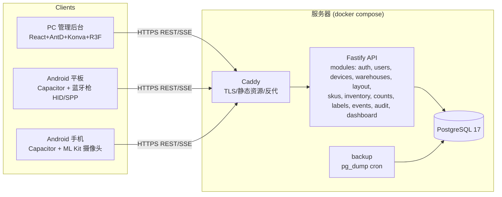

# 01 · 架构（Architecture）

## 1. 技术栈（决策见 ADR-0001/0002；v2 版本均于 2026-11-12 在 npm 核实并锁定）
| 层 | 选型 | 版本基线（2026-11） |
|---|---|---|
| 语言/仓库 | TypeScript 全栈，pnpm workspaces 单仓 | Node 24 LTS、pnpm 10、TypeScript 6.0.x（typescript-eslint 8.72 要求 < 6.1，不用 TS 7） |
| 后端 | Fastify + `fastify-type-provider-zod` + `@fastify/swagger` + Drizzle ORM（SQL-first）+ `pg` + PostgreSQL 17 | fastify 5.12、type-provider-zod 7.0（peer：zod ≥ 4.1.5、fastify ^5.5、swagger ≥ 9.5.1）、@fastify/swagger 9.9、drizzle-orm **0.45** / drizzle-kit **0.31**（不追 1.0 RC）、pg 8.23、argon2 0.45 |
| 契约 | Zod schema（`packages/contracts`）→ OpenAPI 3.1 → 类型安全客户端 + MSW mock | zod 4.6 |
| PC 后台 | React + Vite + Ant Design + TanStack Query + React Router + Zustand；布局设计器 react-konva | react/react-dom **19.3.x**（react-konva 19.3.2 要求 ^19.3.0；R3F 9.8 要求 < 19.4）、antd **6.7**、konva 10.9、vite 8.3、@tanstack/react-query 5.107、zustand 5.1 |
| 移动端 | React 19.3 + Vite + antd-mobile，Capacitor 8 打包为**一个** Android App（平板/手机自适应） | @capacitor/core & android 8.6、antd-mobile 5.43、minSdk 24、target/compile 36、`minWebViewVersion` 99 |
| 原生插件 | 自研 `@wms3d/capacitor-scanner`（Kotlin）：SPP、HID pre-IME 缓冲、feedback、证书指纹校验、Keystore 加密；相机 `@capacitor-mlkit/barcode-scanning`（`startScan` 捆绑模型）；`@capawesome/capacitor-torch`；outbox `@capacitor-community/sqlite`；`@capacitor/haptics` | mlkit 8.2.2、torch 8.0.2、sqlite 8.1.1、haptics 8.0.2；JDK 21、AGP 8.13、Gradle 8.14.3 |
| 3D | three.js + @react-three/fiber + drei（`packages/twin3d`），按巷道分块的 InstancedMesh + troika 文本 | three **0.187.0**、R3F 9.8、drei 10.7、troika-three-text 0.53 |
| 标签 | 服务端 pdfkit + bwip-js 自定义 drawing（矢量条码），ZPL 实验性 | pdfkit 0.20、bwip-js 4.11 |
| 实时 | SSE（客户端 `@microsoft/fetch-event-source` 2.0，Bearer 鉴权） | |
| 本地存储 | Web：Dexie 4（缓存）；移动 outbox：SQLite | dexie 4.4、uuid 14（v7） |
| 部署 | **路径 A（本机已验证）**：原生二进制 + systemd（PG17、Node、Caddy）；**路径 B**：docker compose（postgres/api/caddy/backup，交付但本机未验证） | |
| 测试 | Vitest、Fastify inject + 真实 PG、Playwright（Chrome）、fast-check、Android Gradle 单测 | vitest 5.1、@playwright/test 1.65 |

## 2. 组件图


## 3. 单仓目录结构（模块边界 = 并行开发边界）
```
wms3d/
  apps/
    api/                 # Fastify 服务（WS-A）
      src/modules/{auth,users,devices,warehouses,layout,skus,inventory,counts,labels,events,audit,dashboard}/
      src/db/{schema.ts,migrations/}
    admin/               # PC 后台（WS-B），布局设计器在 src/features/layout-designer（WS-D1）
    mobile/              # 移动端 Web 部分 + capacitor android 工程（含 MainActivity pre-IME Hook）（WS-C）
  packages/
    contracts/           # Zod schema、错误码、枚举、OpenAPI 生成（Lead 所有，变更走评审）
    api-client/          # 基于 contracts 的 fetch 客户端 + TanStack Query hooks
    domain/              # 纯函数：geometry（坐标约定）、编码生成/解析、classifyScan、planMovements、expandLayout/validateLayout
    twin3d/              # three.js/R3F 场景（WS-D2），零业务请求，只吃 TwinModel 数据
    scanner/             # 扫码抽象 TS 层：HID 键盘缓冲、SPP/相机适配、去抖（WS-C）
    labels/              # 标签模板与渲染（PDF/ZPL）纯函数（WS-E），由 api 调用
    ui/                  # 少量共享 React 组件（数量键盘、扫码输入框）
  native/
    capacitor-scanner/   # Kotlin 插件：SPP + HID 缓冲 + feedback + 证书指纹 + Keystore（WS-C）
  infra/                 # native/（systemd + install.sh，已验证路径）、compose/（未验证）、Caddyfile、备份脚本（WS-F）
  scripts/               # dev-db.sh、seed、生成 OpenAPI
  docs/
```
依赖方向（禁止反向）：`apps/* → packages/api-client → packages/contracts`；`apps/* → packages/{domain,twin3d,scanner,labels,ui}`；`packages/twin3d → packages/domain`；`packages/contracts` 不依赖任何内部包。用 `eslint-plugin-boundaries` 强制。

## 4. 后端内部分层
每个模块：`routes.ts`（只做 HTTP + schema）→ `service.ts`（业务事务）→ `repo.ts`（Drizzle 查询）。跨模块只能调用对方 `service` 的公开函数。库存写入**只能**经 `inventory/service.postTransaction()`（唯一写入口，见 02 文档）。

## 5. 关键时序：扫码上架
```mermaid
sequenceDiagram
  participant G as 扫码枪/相机
  participant M as 移动端
  participant Q as 离线队列(IndexedDB)
  participant S as API
  participant D as PostgreSQL
  G->>M: "WH1.A03-17-C02"（仓位条码载荷）
  M->>M: domain.classifyScan() = LOCATION（本地缓存校验）
  G->>M: "6901234567890"（SKU 条码，包装×12）
  M->>M: qty=12，连续模式自动提交
  M->>M: 空闲 3s 自动提交（连续模式）
  M->>Q: 写 SQLite outbox(idempotencyKey=UUIDv7) → 灰勾
  Q->>S: POST /inventory/transactions (Idempotency-Key, Bearer)
  S->>D: BEGIN; INSERT txn ON CONFLICT DO NOTHING; 锁 locations(FOR SHARE/UPDATE); 原子更新 balances; INSERT movements; COMMIT
  S-->>Q: 201 {txn, balancesAfter} → 绿勾
  S-->>M: SSE stock.changed{layoutVersion} → 拉 occupancy → 3D 着色更新
```

## 6. 部署拓扑
- **单机**（MVP 推荐）：1 台 2C4G Linux。路径 A：原生 + systemd（本机已验证）；路径 B：docker compose（未验证）。见 08 §5。
- 证书：推荐真实域名 + Caddy ACME（内网 DNS-01）；或内部 CA（App 信任用户锚点 + 配置二维码 SPKI 指纹启动校验），见 04 §1。
- 移动端 App 内置 Web 资源（离线可启动），API 地址在首次启动时配置（扫服务器配置二维码）。
- PC 后台由 Caddy 提供静态资源，同域 `/api` 反代；移动端跨域走 API 的 CORS allowlist（03 §1.1）；SSE 用 fetch + Bearer（03 §6）。

## 7. 非功能指标
| 指标 | 目标 |
|---|---|
| 扫码提交 API p95 | ≤ 150 ms（局域网） |
| 3D 场景数据接口 | 5,000 仓位 ≤ 300 KB gzip，≤ 300 ms |
| 并发 | 50 台终端同时作业无死锁、无丢失更新 |
| 可用性 | 单机 + 每日备份 + 恢复演练；RPO ≤ 24h（可选 WAL 归档到 15 min） |
| 浏览器 | Chrome/Edge 最近 2 版；Android WebView ≥ 99（`minWebViewVersion` 门槛，实测后调整；无 GMS 机型以厂商 ROM WebView 为准） |

## 8. 本机工具链（2026-11-11 实测）
| 工具 | 状态 |
|---|---|
| Node 24.22 / pnpm 10.34 / git 2.47 / Python 3.13 | 预装 |
| PostgreSQL 17.11 服务端 | Debian apt 源在本机网络不可用，改用 zonky 预编译二进制装到 `/opt/tools/pg17`，已验证 initdb/启动 |
| JDK 21（Temurin） | 已装到 `/opt/tools/jdk21` |
| Android SDK（cmdline-tools、platform-tools、platforms;android-36、build-tools;36.0.0） | 已装到 `/opt/tools/android-sdk` |
| Docker | 不可用（apt 不通）；交付以原生 systemd 路径为已验证路径，compose 标注未验证；M0a 尝试 Docker 官方静态二进制（`download.docker.com` 本机 https 可达） |
| Google Chrome | 预装（Playwright e2e / 3D 性能基准可用） |

环境变量：`source /opt/tools/env.sh`（JAVA_HOME / ANDROID_HOME / PG 二进制入 PATH）。Spike：Capacitor 8 空工程 `./gradlew assembleDebug` 成功（首次需下载 Gradle 8.14.3，自动补装 build-tools 35）。
