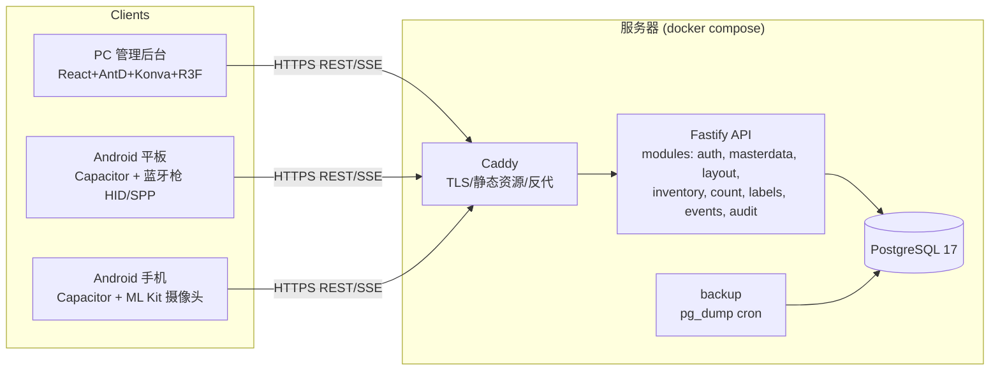

# 01 · 架构（Architecture）

## 1. 技术栈（决策见 ADR-0001/0002）
| 层 | 选型 | 版本基线（2026-11） |
|---|---|---|
| 语言/仓库 | TypeScript 全栈，pnpm workspaces 单仓 | Node 24 LTS, pnpm 10 |
| 后端 | Fastify 5 + `fastify-type-provider-zod` + Drizzle ORM（SQL-first）+ PostgreSQL 17 | |
| 契约 | Zod 4 schema（`packages/contracts`）→ OpenAPI 3.1 → 类型安全客户端 | |
| PC 后台 | React 19 + Vite + Ant Design 5 + TanStack Query + React Router；布局设计器 react-konva | |
| 移动端 | React 19 + Vite + antd-mobile 5，Capacitor 8 打包为**一个** Android App（平板/手机自适应） | minSdk 24, target/compile 36 |
| 原生插件 | 自研 Capacitor 插件 `@wms3d/capacitor-scanner`（Kotlin）：SPP 串口 + HID 按键拦截；摄像头用 `@capacitor-mlkit/barcode-scanning@8`（捆绑模型，不依赖 GMS） | JDK 21, AGP 8.13 |
| 3D | three.js + @react-three/fiber + drei（`packages/twin3d`），InstancedMesh | three r18x |
| 标签 | 服务端 pdfkit + bwip-js（矢量条码），ZPL 文本模板（可选） | |
| 实时 | Server-Sent Events（库存变动推送） | |
| 部署 | Docker Compose：caddy（TLS+静态+反代）/ api / postgres / backup | |
| 测试 | Vitest、Fastify inject + 真实 PG、Playwright（Chrome）、Android Gradle 单测 | |

## 2. 组件图


## 3. 单仓目录结构（模块边界 = 并行开发边界）
```
wms3d/
  apps/
    api/                 # Fastify 服务（WS-A）
      src/modules/{auth,users,warehouses,layout,skus,inventory,counts,labels,events,audit,dashboard}/
      src/db/{schema.ts,migrations/}
    admin/               # PC 后台（WS-B），布局设计器在 src/features/layout-designer（WS-D 协作）
    mobile/              # 移动端 Web 部分 + capacitor android 工程（WS-C）
  packages/
    contracts/           # Zod schema、错误码、枚举、OpenAPI 生成（Lead 所有，变更走评审）
    api-client/          # 基于 contracts 的 fetch 客户端 + TanStack Query hooks
    domain/              # 纯函数：仓位编码生成/解析、条码分类、数量规则、布局→仓位展开
    twin3d/              # three.js/R3F 场景（WS-D），零业务请求，只吃 TwinModel 数据
    scanner/             # 扫码抽象 TS 层：HID 键盘缓冲、SPP/相机适配、去抖（WS-C）
    labels/              # 标签模板与渲染（PDF/ZPL）纯函数（WS-E），由 api 调用
    ui/                  # 少量共享 React 组件（数量键盘、扫码输入框）
  native/
    capacitor-scanner/   # Kotlin 插件：SPP + HID 拦截（WS-C）
  infra/                 # docker-compose、Caddyfile、备份脚本（WS-F）
  scripts/               # dev-db.sh、seed、生成 OpenAPI
  docs/
```
依赖方向（禁止反向）：`apps/* → packages/api-client → packages/contracts`；`apps/* → packages/{domain,twin3d,scanner,labels,ui}`；`packages/twin3d → packages/domain`；`packages/contracts` 不依赖任何内部包。用 `eslint-plugin-boundaries` 强制。

## 4. 后端内部分层
每个模块：`routes.ts`（只做 HTTP + schema）→ `service.ts`（业务事务）→ `repo.ts`（Drizzle 查询）。跨模块只能调用对方 `service` 的公开函数。库存写入**只能**经 `inventory/service.postTransaction()`（唯一写入口，见 02 文档）。

## 5. 关键时序：扫码上架
```mermaid
sequenceDiagram
  participant G as 扫码枪/相机
  participant M as 移动端
  participant Q as 离线队列(IndexedDB)
  participant S as API
  participant D as PostgreSQL
  G->>M: "A03-12-C02"（仓位）
  M->>M: domain.classify() = LOCATION（本地缓存校验）
  G->>M: "6901234567890"（SKU 条码，包装×12）
  M->>M: qty=12，连续模式自动提交
  M->>Q: enqueue(op, idempotencyKey=UUIDv7)
  Q->>S: POST /inventory/transactions (Idempotency-Key)
  S->>D: BEGIN; INSERT txn(唯一键); UPSERT balance ... ; INSERT movements; COMMIT
  S-->>Q: 201 {txnId, balances}
  S-->>M: SSE stock.changed → 3D 着色更新
```

## 6. 部署拓扑
- **单机**（MVP 推荐）：1 台 2C4G Linux，docker compose 起 caddy/api/postgres/backup；局域网或公网域名（Caddy 自动 TLS；内网用内部 CA 并在 App 中信任）。
- 移动端 App 内置 Web 资源（离线可启动），API 地址在首次启动时配置（扫服务器配置二维码）。
- PC 后台由 Caddy 提供静态资源，同域 `/api` 反代，避免 CORS。

## 7. 非功能指标
| 指标 | 目标 |
|---|---|
| 扫码提交 API p95 | ≤ 150 ms（局域网） |
| 3D 场景数据接口 | 5,000 仓位 ≤ 300 KB gzip，≤ 300 ms |
| 并发 | 50 台终端同时作业无死锁、无丢失更新 |
| 可用性 | 单机 + 每日备份 + 恢复演练；RPO ≤ 24h（可选 WAL 归档到 15 min） |
| 浏览器 | Chrome/Edge 最近 2 版；Android System WebView ≥ 110 |

## 8. 本机工具链（2026-11-11 实测）
| 工具 | 状态 |
|---|---|
| Node 24.22 / pnpm 10.34 / git 2.47 / Python 3.13 | 预装 |
| PostgreSQL 17.11 服务端 | Debian apt 源在本机网络不可用，改用 zonky 预编译二进制装到 `/opt/tools/pg17`，已验证 initdb/启动 |
| JDK 21（Temurin） | 已装到 `/opt/tools/jdk21` |
| Android SDK（cmdline-tools、platform-tools、platforms;android-36、build-tools;36.0.0） | 已装到 `/opt/tools/android-sdk` |
| Docker | 不可用（apt 不通）；compose 文件照写，部署验证放到目标服务器 |
| Google Chrome | 预装（Playwright e2e / 3D 性能基准可用） |

环境变量：`source /opt/tools/env.sh`（JAVA_HOME / ANDROID_HOME / PG 二进制入 PATH）。Spike：Capacitor 8 空工程 `./gradlew assembleDebug` 成功（首次需下载 Gradle 8.14.3，自动补装 build-tools 35）。
