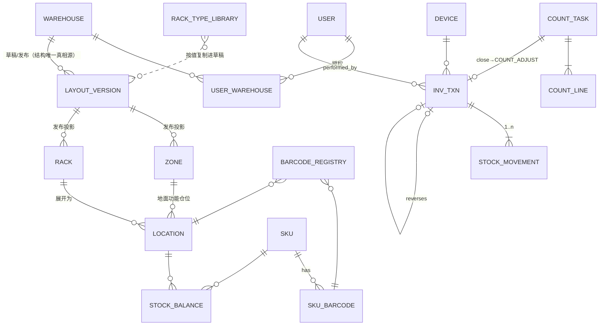

# 02 · 领域模型（Domain Model）

> v2（2026-11-12）：按 R1 评审重写编码规则、坐标约定、幂等、锁顺序、盘点、真相源与条码命名空间。条目编号见 `reviews/R1-resolution.md`（D=领域后端评审，M=移动/3D/标签评审）。
> **v2.1**（2026-11-12）：按 R2 修正巷道行进方向与右侧 bay 方向（N1）、发布两轮匹配（B-N3）、盘点关闭单事务（B-N4）、换班代交 `device_sessions`（B-N6）、冲正规则（B-N15）、advisory lock 双键（B-N16）、分类器顺序（M-N12）。见 `reviews/R2-resolution.md`。

## 1. ERD


## 2. 坐标与方向约定（M18，M0 契约冻结前置条件）
所有端（2D 设计器、3D、仓位展开、标签）共用 `packages/domain/geometry.ts`，并以黄金样例单测锁定。

| 项 | 约定 |
|---|---|
| 单位 | 米（存储 `numeric(9,3)`，前端 number） |
| 世界坐标 | 右手系，**Y 向上**；俯视时 **+X 向右、+Z 向屏幕下方**；原点 = 平面图**左上角**地面 |
| 2D 画布 ↔ 世界 | Konva `(u, v)`（像素/比例尺换算后单位米）→ 世界 `(x = u, z = v)`，**不翻转**（俯视右手系即此方向，无镜像） |
| 旋转 | `rotationDeg` = **俯视顺时针**为正；MVP 仅允许 0/90/180/270（M34，字段保留任意值供以后）；Konva `rotation = rotationDeg`；three `rotation.y = −rotationDeg·π/180` |
| 货架局部系 | 原点 = **站在巷道里面对取货面时货架的左-前-下角**（基点，也是旋转中心）；局部 +x = 操作员右手方向（沿货架长度），局部 −z = 向货架深处，+y 向上。rotation 0 时：取货面朝屏幕下方（+Z），货架向屏幕上方延伸 |
| 巷道行进方向（v2.1） | **水平巷道**（货架 rotation 0/180）沿 **+X** 行进；**竖直巷道**（rotation 90/270）沿 **+Z** 行进（俯视即向右 / 向下） |
| 侧别（v2.1，推导） | 由旋转推导，不人工填写：rotation **0 / 90 → L**（行进方向左侧），**180 / 270 → R**。推导依据：rotation 0 的货架取货面朝 +Z，位于巷道北侧，沿 +X 行进时在左手边；rotation 90 取货面朝 −X，位于巷道东侧，沿 +Z 行进时在左手边，以此类推 |
| 编号方向（v2.1） | **bay 沿巷道行进方向递增**（左侧货架面对时从左到右，右侧货架面对时从右到左）；**position 一律面对取货面从左到右**；level 自下而上（A=最底层） |
| 取货面 | 每个货架只有一个取货面（局部 z=0 面）；v1 的 `face: FRONT/BACK` **删除**——背靠背货架是两个货架，各属不同巷道；需要反向就旋转 180° |
| 包围盒 | 货架占地 `[0, L] × [−D, 0]`（局部），`L = bays·bayWidthM + (bays+1)·uprightM`，`D = depthM` |

黄金样例（`domain/__fixtures__/geometry-golden.json`）：同一模板在 0/90/180/270° 下，bay1/level A/pos1 仓位中心的世界坐标、四角点；**一条水平巷道和一条竖直巷道，两侧各 2 个货架**（断言 bay 1 与 bay 2 隔巷道正对、两侧 bay 沿行进方向单调递增、侧别推导正确）；2D 预览、3D 预览、标签立面图三处测试共用。

## 3. 仓位编码规则（D14/M1，ADR-0008 v2）
### 3.1 最终方案：巷道连续 bay 编号 + 奇偶分侧
- **仓位码**：`{Zone:1}{Aisle:2}-{Bay:2}-{Level:A}{Pos:2}`，例如 **`A03-17-C02`** = A 区 03 巷道、第 17 列（奇数 → 巷道左侧）、C 层（自下第 3 层）、第 02 位。
- **bay 是巷道级编号**（v2.1 修正方向，B-N1/M-N1）：每个货架记录 `aisle`、`bayStart`；`side` 由旋转推导（§2）。沿巷道行进方向，**左侧奇数（1,3,5…）右侧偶数（2,4,6…）**，`bayStart` = 该货架**靠行进起点一端**的最小号（左侧奇数、右侧偶数）。设 i 为面对取货面从左到右的局部列序号（0 起）：
  - **L 侧**：`bay = bayStart + 2i`（面对 L 货架时右手指向行进方向）
  - **R 侧**：`bay = bayStart + 2·(bays − 1 − i)`（面对 R 货架时右手指向行进反方向）
  - 结果：bay 1 与 bay 2 隔巷道正对，两侧编号都沿行进方向递增，字典序 ≈ 行走顺序；默认 `pick_seq` 按 (zone, aisle, bay, level, position) 生成，巷道间蛇形（奇数巷道正向、偶数巷道反向）。
- 设计器"阵列复制"沿**行进方向**排序后递增 `bayStart`（上一货架 bayStart + 2·bays）；货架放置时按所在巷道、推导侧别自动建议 aisle 与 bayStart，人工可改 aisle/bayStart。
- `validateLayout` 校验：同 (zone, aisle, side) 的 bay 区间不重叠、奇偶正确；**几何一致性**——同一巷道的 L 货架取货面共线、R 货架取货面共线，且两条取货面线之间就是该巷道（水平巷道：`z_face(R) > z_face(L)`；竖直巷道：`x_face(L) > x_face(R)`），间距 < 1.2m 警告；全部生成编码唯一；编码长度 ≤ 标签模板容量（M30）。
- 宽度：Bay 默认 2 位（每侧 ≤ 49 列）；超过时仓库模式可配置为 `{Bay:3}`。
- **货架码**：`R{Zone}{Aisle:2}-{Side}{RackNo:2}` → `RA03-L02`（巷道 A03 左侧第 2 个货架）。
- **地面功能仓位**：`RCV-01`、`SHP-01`、`QC-01`（Zone 编码 3 字母保留给功能区）。
- 字符集 `[A-Z0-9-]`；数字定宽补零；所有 code 列 `COLLATE "C"`（D22），保证字典序 ≈ 行走顺序且 dev/prod 一致。
- 每仓库 `location_code_pattern` 可配置（段：`{Zone}{Aisle:n}{Bay:n}{Level:A|n}{Pos:n}{Side}` + 字面量 `-`），**仓库内已存在仓位即不可改**（由 `EXISTS(locations)` 推导，删除 v1 的 `code_locked` 列，D21）。
- `pick_seq`（步长 10）单独存储，拣货/盘点排序用。

### 3.2 条码内容与命名空间（D18/M19）
- **条码载荷 ≠ 编码**：仓位/货架标签的 Code128/QR 内容默认为 `{WarehouseCode}.{code}`，例如 `WH1.A03-17-C02`（`.` 只出现在载荷里，不出现在任何 code 列；美式键盘无需 Shift，HID 安全）。仓库级开关 `barcode_prefix_enabled`（默认 **开**）。
- 分类器 `domain.classifyScan(text, ctx)`（统一函数名，D48）：
  1.（v2.1，M-N12）先用**整串原文**精确匹配 `barcode_registry` / 本地缓存（SKU 条码保持原样，避免把 `AB1.234` 这类 SKU 条码误判为跨仓）。
  2. 未命中 → 转大写（仓位/货架载荷与编码只含大写，兼容 Caps Lock 输出）后再精确匹配。
  3. 仍未命中 → 解析前缀 `^([A-Z0-9]{2,4})\.(.+)$`：前缀为**已知仓库**且 ≠ 当前仓库 → `WRONG_WAREHOUSE`；= 当前仓库 → 用余下部分匹配仓位/货架。
  4. 无前缀：匹配当前仓库裸仓位码/货架码（手输与旧标签），否则 `UNKNOWN`。
  契约：交易命令的 `locationCode` 接受**载荷形式**（`WH1.A03-17-C02`）与**裸编码**两种，服务端统一剥离并校验前缀。
- **组织级登记表**（实体表，不是视图）：
  ```sql
  barcode_registry(value text COLLATE "C" primary key,
                   kind text check in ('SKU','LOCATION','RACK'), warehouse_id uuid null, entity_id uuid not null)
  ```
  SKU 条码、仓位载荷（带前缀）、货架载荷在**同一事务**插入登记表，由主键裁决冲突。另外，SKU 条码不得等于任何仓库的**裸**仓位码：SKU 条码写入与布局发布都先取 `pg_advisory_xact_lock(LOCK_NS.BARCODE, 0)` 串行化，再校验（低频操作，串行代价可忽略）。
- **advisory lock 统一双 int 形式**（v2.1，B-N16）：`pg_advisory_[xact_]lock(<命名空间常量>, <id>)`，常量集中在 `apps/api/src/db/locks.ts`：`BARCODE=1`、`MIGRATION=2`、`JOB=3`（id = 任务编号）、`LAYOUT_PUBLISH=4`（id = 仓库内部序号）。禁止 `hashtext()` 单 key 形式。
- 删除 v1 的 `locations.barcode` 列：载荷一律由 `warehouse.code + location.code` 派生。

## 4. 结构数据真相源（D19/D20/M34）
- **布局文档 `layout_versions.doc` 是几何与编码的唯一真相源**；`zones / racks / locations` 是**发布时生成的投影**（API 只读，不提供 zone/rack 的独立写端点）。
- 全局 `rack_types` = "模板库"（带 `key`）；放入草稿时**按值复制**到 `doc.rackTypes`，发布后不随模板库修改而变化。
- **运行时属性**只存在 `locations` 表、不进布局文档、发布时保留：`is_active`、`max_qty`、`pick_seq`（立面视图的停用/容量直接 `PATCH /locations/:id`）。v1 中的 `max_weight` 删除（MVP 不做重量）。
- 有效容量 `effective_max = locations.max_qty ?? rackType.default_max_qty ?? NULL`；`fill = effective_max ? min(1, qty/effective_max) : (qty>0 ? 1 : 0)`，恒在 [0,1]（D49）。

## 5. 核心表
```sql
-- 账号（运行时角色 wms_app 设置 `ALTER ROLE wms_app SET transaction_timeout = '30s'`，PG17 新 GUC；布局发布：**在 BEGIN 之前**会话级 `SET transaction_timeout = '120s'`、结束后 `RESET`——v2.2 实测 PG 17.11：计时从事务开始，事务内 `SET LOCAL` 无法延长，见 `apps/api/src/db/client.ts` 的 `withLongTransaction`，v2.1 B-N7 / R3）
users(id uuid pk, username citext unique, display_name, password_hash, role text check in ('ADMIN','MANAGER','OPERATOR','VIEWER'),
      all_warehouses bool default false, must_change_password bool default true, is_active bool, created_at, updated_at)
user_warehouses(user_id, warehouse_id, role_override text null /*预留，MVP 不启用（D26）*/, pk(user_id, warehouse_id))
refresh_tokens(id uuid pk, user_id, device_id, family_id uuid, token_hash, parent_id uuid null,
               replaced_by uuid null, replaced_at timestamptz null,
               sibling_of uuid null /*v2.1 B-N13：60s 宽限期内签发的同 family 兄弟 token*/, expires_at, revoked_at)
device_sessions(id uuid pk, device_id, user_id, started_at timestamptz, ended_at timestamptz null)   -- v2.1 B-N6：换班代交依据
devices(id varchar(64) pk, name, model, last_user_id, last_seen_at, app_version, pending_outbox int default 0,
        disabled_at timestamptz null)

-- 仓库与布局
warehouses(id uuid pk, code varchar(4) COLLATE "C" unique check (code ~ '^[A-Z0-9]{2,4}$'), name, timezone text default 'Asia/Shanghai',
           width_m, depth_m, height_m, location_code_pattern text, barcode_prefix_enabled bool default true,
           allow_mixed_sku bool default true, published_layout_version int null,
           unique(id, code))
layout_versions(id bigserial pk, warehouse_id, version int null /*发布时分配*/, status text check in ('DRAFT','PUBLISHED','ARCHIVED'),
                doc jsonb, row_version int not null default 0, based_on_version int null,
                created_by, created_at, published_at, published_by,
                unique(warehouse_id, version))
  -- 每仓库最多一个草稿（D23）
  CREATE UNIQUE INDEX one_draft ON layout_versions(warehouse_id) WHERE status='DRAFT';
rack_types(id uuid pk, key varchar(32) unique, name, bays, levels, positions_per_level, bay_width_m, depth_m,
           level_heights_m jsonb, beam_m, upright_m, default_max_qty int null)       -- 模板库
zones(id uuid pk, warehouse_id, layout_version int, code varchar(4) COLLATE "C", name, kind text check in ('STORAGE','RECEIVING','SHIPPING','QC'),
      polygon jsonb, color, unique(warehouse_id, code))                              -- 投影
racks(id uuid pk, warehouse_id, zone_id, layout_key varchar(32), code varchar(16) COLLATE "C",
      aisle int, side char(1) check in ('L','R'), rack_no int, bay_start int, rack_type jsonb /*快照*/,
      pos_x, pos_z, rotation_deg, is_active bool, layout_version int,
      unique(warehouse_id, code), unique(warehouse_id, layout_key))                   -- 投影
locations(id uuid pk, warehouse_id, zone_id, rack_id null, code varchar(32) COLLATE "C",
          bay int null /*巷道级*/, level int null, position int null, rack_bay_index int null /*货架内 0 基*/,
          kind text check in ('STORAGE','RECEIVING','SHIPPING','QC'),
          pick_seq int, max_qty int null, is_active bool default true, updated_at, created_at,
          unique(id, warehouse_id),
          unique(warehouse_id, code) DEFERRABLE INITIALLY DEFERRED,                  -- D15 改码互换
          unique(rack_id, rack_bay_index, level, position))

-- 主数据（组织级，D25）
skus(id uuid pk, code varchar(64) COLLATE "C" unique, name, spec, uom default 'EA', length_mm, width_mm, height_mm, weight_g,
     safety_stock int default 0, is_active bool, image_url null, created_at, updated_at)
sku_barcodes(id uuid pk, sku_id, barcode varchar(64) COLLATE "C" unique, pack_qty int default 1 check (pack_qty >= 1),
             is_primary bool, updated_at)
masterdata_tombstones(id bigserial, entity text, entity_id uuid, warehouse_id null, deleted_at timestamptz default now())
barcode_registry(...)   -- 见 §3.2
-- updated_at 由触发器维护（skus, sku_barcodes, locations）

-- 库存（ADR-0003 v2）
inv_txns(id uuid pk, warehouse_id, type text check in ('INBOUND','OUTBOUND','TRANSFER','ADJUST','COUNT_ADJUST','REVERSAL'),
         idempotency_key varchar(80) not null, request_hash char(64) not null,
         reason text null /*ADJUST 原因码*/, ref_no varchar(64) null, note text,
         reverses_txn_id uuid null unique /*一笔交易只能被冲正一次*/,
         performed_by uuid not null /*实际操作员*/, submitted_by uuid not null /*令牌用户；换班代交时可不同（§6.6）*/, device_id varchar(64),
         created_offline bool not null default false /*客户端离线时创建（WAITING_STOCK 适用范围）*/,
         client_created_at timestamptz, created_at timestamptz default now(),
         unique(warehouse_id, idempotency_key))                                         -- D3
stock_movements(id bigserial pk, txn_id, warehouse_id, location_id, sku_id, lot_no varchar(32) not null default '',
                qty_delta int not null check (qty_delta <> 0), balance_after int not null check (balance_after >= 0),
                created_at, foreign key(location_id, warehouse_id) references locations(id, warehouse_id))   -- D9
stock_balances(warehouse_id, location_id, sku_id, lot_no varchar(32) not null default '',
               on_hand int not null default 0 check (on_hand >= 0), updated_at,
               primary key(location_id, sku_id, lot_no),
               foreign key(location_id, warehouse_id) references locations(id, warehouse_id))
reconcile_checkpoints(id bigserial, max_movement_id bigint, ran_at, mismatches int, full_run bool)   -- D12

-- 通用幂等（非库存写入，D5）
idempotency_keys(scope text, key varchar(80), user_id, request_hash char(64), response jsonb, created_at,
                 primary key(scope, key))

-- 盘点（D10）
count_tasks(id uuid pk, warehouse_id, code, scope jsonb, blind bool default true,
            status text check in ('OPEN','COUNTING','REVIEW','CLOSED','CANCELLED'), created_by, closed_txn_id null, closed_at)
count_lines(id uuid pk, task_id, location_id, sku_id, lot_no default '',
            snapshot_qty int null /*仅展示*/, system_qty_at_count int not null, counted_qty int not null,
            variance int generated always as (counted_qty - system_qty_at_count) stored,
            counted_by, counted_at, client_counted_at, submission_id uuid,
            needs_review bool default false, unique(task_id, location_id, sku_id, lot_no))

-- 审计（D34）
audit_logs(id bigserial, at timestamptz, user_id null, warehouse_id null, action, entity, entity_id, result text check in ('SUCCESS','DENIED','FAILED'),
           before jsonb, after jsonb, ip, device_id, trace_id)
```
- 数量为**整数基本单位**；`lot_no` 预留，MVP UI 隐藏。v1 的 `stock_balances.version`（无读写方）删除（D13）；`inv_txns.status` 删除（D11）。
- 只读视图：`v_sku_stock(sku_id, warehouse_id, on_hand_total, location_count)`、`v_location_occupancy(location_id, sku_count, qty_total, fill)`（fill 按 §4 公式）。

### 5.1 不可变性与数据库角色（D11）
- `inv_txns / stock_movements / audit_logs`：行级 `BEFORE UPDATE OR DELETE` 触发器报错 + 语句级 `BEFORE TRUNCATE` 触发器报错。
- 角色拆分：`wms_owner`（迁移、属主）与 `wms_app`（运行时）。`wms_app` 对上述三表仅 `INSERT, SELECT`（`REVOKE UPDATE, DELETE, TRUNCATE`），不是表属主，无法 `DISABLE TRIGGER`。dev-db.sh、systemd 部署脚本与 compose 初始化脚本均按此创建。
- 更正 = `REVERSAL` 交易（逐行反向分录），见 §6.4。

## 6. 库存写入（唯一入口 `postTransaction`）
### 6.1 计划（纯函数，D8）
`domain.planMovements(cmd) → { lockLocations: id[] (升序), deltas: [{locationId, skuId, lotNo, delta}] (按键升序) }`
- TRANSFER 每行展开为 (from, −q) 与 (to, +q)；**同键合并**（delta 求和；合并后为 0 → `VALIDATION_FAILED`）。
- Zod：每命令 ≤ 200 行；INBOUND/OUTBOUND/TRANSFER `qty: int().positive()`；ADJUST `qtyDelta: int().refine(≠0)`；TRANSFER `from ≠ to`；COUNT_ADJUST/REVERSAL 不接受客户端直接提交（不在客户端判别联合中）。

### 6.2 事务步骤（READ COMMITTED）
```sql
BEGIN;
-- ① 幂等占位（D1）：冲突不报错，不会让事务中止
INSERT INTO inv_txns (...) VALUES (...) ON CONFLICT (warehouse_id, idempotency_key) DO NOTHING RETURNING id;
--   0 行 → 在同一事务的新语句中 SELECT 已提交行（READ COMMITTED 每条语句取新快照；若对方事务未结束，ON CONFLICT 会先等待其结束；
--          对方回滚则本次 INSERT 成功并继续执行——即"失败的键不留痕，同键重放会重新执行"）
--          比对 request_hash 与 performed_by/device_id：一致 → 200 replayed（按 §6.3 重建结果）；不一致 → 409 IDEMPOTENCY_KEY_REUSED（不泄露首次内容，D3）
-- ② 锁仓位（D7/D9）：按 id 升序
SELECT id, is_active, max_qty, kind, rack_id FROM locations
 WHERE id = ANY($ids) AND warehouse_id = $wh ORDER BY id FOR SHARE;           -- 行数不符 → 404（跨仓或不存在）
--   若命令含入库方向且（仓位设了 effective_max 或仓库禁止混放）→ 对这些仓位改用 FOR UPDATE（串行化同仓位入库）
--   锁内校验：is_active（LOCATION_INACTIVE）、容量（LOCATION_CAPACITY_EXCEEDED，按仓位全部 SKU 合计）、混放（MIXED_SKU_NOT_ALLOWED）
-- ③ 余额（按 (location_id, sku_id, lot_no) 升序逐键）
--   扣减：UPDATE stock_balances SET on_hand = on_hand - $q, updated_at = now()
--          WHERE location_id=$l AND sku_id=$s AND lot_no=$lot AND on_hand >= $q RETURNING on_hand;   -- 0 行 → 422 INSUFFICIENT_STOCK，整单回滚
--   增加：INSERT ... ON CONFLICT (location_id, sku_id, lot_no) DO UPDATE SET on_hand = stock_balances.on_hand + EXCLUDED.on_hand RETURNING on_hand;
--   每键写 stock_movements(qty_delta, balance_after)
-- ④ 审计（调整/冲正类）同事务写 audit_logs（D34）
COMMIT;  -- 提交后发布进程内事件 stock.changed
```
**全局锁顺序（写入 ADR-0003）**：`locations(id 升序)` → `stock_balances(location_id, sku_id, lot_no 升序)`。所有改动仓位状态的流程（布局发布、`PATCH /locations/:id` 停用、盘点提交）都遵守同一顺序：
- 停用/发布删除：`SELECT ... FROM locations WHERE id = ANY(...) ORDER BY id FOR UPDATE` → 检查 `stock_balances` 合计为 0 → `is_active=false`。与入库的 `FOR SHARE` 互斥，消除"检查后停用前入库"的悬空库存（R5 真因）。
- 两个方向相反的 TRANSFER（A→B、B→A）因统一排序不会环形死锁；仍保留死锁（40P01）重试 1 次的兜底。

### 6.3 返回与重放（D2）
响应 `{ txn, balancesAfter: [{locationId, skuId, lotNo, onHand}], replayed }`；`balancesAfter` 定义为"**该交易提交后的余额**"，重放时由 `stock_movements.balance_after` 重建（不冗余存响应）。

### 6.4 冲正（D11/M5）
`POST /inventory/transactions/:id/reverse`（带幂等键）：生成 `REVERSAL` 交易，逐行反向；余额不足 → 422；已冲正 → 409 `TXN_ALREADY_REVERSED`（`reverses_txn_id unique`）。权限：MANAGER+ 任意；OPERATOR 仅限**本人、同设备、提交后 10 分钟内**（支撑移动端"撤销上一笔"）。
规则（v2.1，B-N15）：
- `REVERSAL` 交易**不可再冲正**（`REVERSAL_NOT_ALLOWED`）；需要恢复就重新做一笔正常交易。
- `COUNT_ADJUST` 只允许 MANAGER+ 冲正。
- 冲正需要把库存加回**已停用仓位**时 → 422 `LOCATION_INACTIVE`；主管需先重新启用该仓位，或改用 ADJUST 到其他仓位。
- 移动端撤销一条处于 `SENDING` 的单据：等待该请求的响应，成功后再走 reverse；失败（被拒）则无需撤销。单测覆盖四条规则。

### 6.6 换班代交（v2.1，B-N6 / M-N9）
- 共享平板轮班是常态：A 可以带着未同步单据**正常登出**，单据归属不变，设备上的发送器继续用**当前登录用户（B）的令牌**补传。
- 服务端接受 `performedBy ≠ 令牌用户` 的条件（**v2.2，R3：改为按会话归属校验，不再比对设备时钟**）：单据带 `performerSessionId`，且该 `device_sessions` 行 ① 属于 performedBy；② `device_id` = 令牌 `did`（单据设备取自令牌，body 无 deviceId）；③ `started_at` 在最近 72 小时内；④ `started_at` 早于（或等于）当前令牌会话（`sid`）的 `started_at`；⑤ performedBy 账号仍为启用状态。否则 403 `PERFORMER_NOT_ALLOWED`（进异常单，交主管处理）。离线单在入队时记录当时登录会话的 `sessionId`（登录响应 `session.id`）。
- **残余风险（书面接受）**：同一设备上的后继用户 B 若恶意构造单据，可在 72 小时内把操作记到前一位操作员 A 名下（A 的会话 id 曾在本机出现）。缓解：`performed_by`/`submitted_by`/`performer_session_id` 全部入审计；看板与交接班报表列出“代交单据”，主管可追溯与冲正。
- `inv_txns` 分别记录 `performed_by`（A）与 `submitted_by`（B），审计可追溯。
- 登录/登出/令牌过期分别开启/关闭会话；设备上无人登录时发送器暂停（`BLOCKED_AUTH`），任何用户在该设备登录后自动继续。

### 6.5 不变量与对账（D12/D50）
- `on_hand = SUM(qty_delta)`（FULL OUTER JOIN + COALESCE 0，缺失余额行视为 0）；存在余额行的键：最新 movement 的 `balance_after = on_hand`。
- 增量对账：从 `reconcile_checkpoints.max_movement_id` 之后涉及的键做校验；每周全量。夜间任务用 `pg_try_advisory_lock(LOCK_NS.JOB, <任务编号>)` 防重复，按仓库 `timezone` 定时。

## 7. 业务规则
| 规则 | 说明 |
|---|---|
| 混放 | `warehouses.allow_mixed_sku`（默认允许），在锁内校验 |
| 容量 | `effective_max`，锁内按仓位全部 SKU 合计校验；MANAGER 可带 `force=true`（审计） |
| 停用仓位 | 有库存不能停用/删除（锁内校验） |
| 负库存 | 禁止（条件扣减 + CHECK） |
| 离线库存不足 | 仅 `created_offline` 的单据进入客户端 `WAITING_STOCK` 延迟重试（04 §5，v2.1 B-N5）；在线创建的单据收到 `INSUFFICIENT_STOCK` 立即打断提示 |
| 低库存 | SKU 总在库 < safety_stock → 预警列表 |
| 业务时间 | 报表"今日"按 `client_created_at`（若与服务端时间相差 > 24h 则用 `created_at`），按仓库时区截断（D31） |
| 0 余额行 | 保留 90 天后清理（对账口径见 §6.5） |

### 7.1 ADJUST 原因码（contracts 枚举，D31）
`DAMAGE`（破损）、`LOST`（丢失）、`FOUND`（盘盈/找到）、`EXPIRED`、`DATA_FIX`（录入纠错，需填 ref_no 指向异常单）、`OTHER`（必须填 note）。

## 8. 盘点：提交即对账（D10）
1. 创建任务：scope（库区/货架/仓位列表），写 `snapshot_qty`（仅展示，盲盘不下发）。
2. **提交**（按仓位整体，`POST /counts/:id/submissions`，天然幂等）：
   - 事务内：锁该仓位 `locations FOR UPDATE`（遵守锁顺序）→ 读取该仓位**全部**余额 → 对提交中的每个 SKU 与"余额中有但未扫到"的 SKU（计为 0）upsert `count_lines(system_qty_at_count, counted_qty)`；快照中没有的新 SKU 直接新增行。
   - 同一 (task, location) 再次提交 = **整体覆盖**（重新读取当时余额），因此重放安全；`submission_id` 记录客户端幂等键用于审计。
   - 这样差异在提交时刻固定，与之后的正常出入库无关；离线计数按**服务端提交时刻**的余额对账。v2.1（B-N12）：`server_now − client_counted_at > 5 分钟` 时该仓位所有行自动标记 `needs_review`；提交前只阻塞本机 outbox 中**涉及该仓位**的待传单据（而非整个 outbox）。
3. 审核（REVIEW）：显示 variance；可对单仓位"重盘"（重新提交覆盖）。
4. 关闭（v2.1，B-N4：**单事务、无部分成功**）：在**同一个事务**内依次执行 ① CAS `UPDATE count_tasks SET status='CLOSED', closed_at=now() WHERE id=$1 AND status='REVIEW' RETURNING id`（0 行 → 若已 CLOSED 返回已有 `closed_txn_id`，否则 409）；② 以幂等键 `count-close:{taskId}` 调用 `postTransaction` 生成 **delta 型** COUNT_ADJUST（每行 delta = variance）；③ 回写 `closed_txn_id`；提交。任一行负 delta 扣减不足 → **整个事务回滚**，任务留在 REVIEW，这些行标记 `needs_review` 并返回 422 `COUNT_RECOUNT_REQUIRED`（含行列表），由主管安排重盘后再关闭。不存在 CLOSED 但没有调整单的中间态。
5. 关闭前检查：若该仓库有设备 `pending_outbox > 0` → 警告"仍有 N 条待同步"，MANAGER 可确认继续。

## 9. 布局文档与发布
```jsonc
{
  "schemaVersion": 2,
  "warehouse": {"widthM": 60, "depthM": 40, "heightM": 10},
  "zones": [{"code":"A","kind":"STORAGE","polygon":[[0,0],[30,0],[30,40],[0,40]],"color":"#5B8FF9"}],
  "rackTypes": [{"key":"std-4x5","bays":4,"levels":5,"positionsPerLevel":2,"bayWidthM":2.7,"depthM":1.0,
                 "levelHeightsM":[1.5,1.5,1.5,1.5,1.5],"beamM":0.1,"uprightM":0.08,"defaultMaxQty":null}],
  "racks": [{"key":"r1","zone":"A","type":"std-4x5","aisle":3,"rackNo":1,"bayStart":1,
             "x":2.0,"z":6.0,"rotationDeg":0}],
  "floorAreas": [{"zone":"RCV","locationCode":"RCV-01","polygon":[[50,0],[60,0],[60,8],[50,8]]}]
}
```
发布流程（`POST /warehouses/:id/layout/publish`，幂等 + CAS）：
1. `pg_advisory_xact_lock(LOCK_NS.BARCODE, 0)`（v2.2，R3：统一双 int 形式）；`UPDATE layout_versions SET status='PUBLISHED', version=$next ... WHERE id=$draft AND status='DRAFT' AND row_version=$rv`（0 行 → 409/412；重复点击返回已发布版本，D5）。
2. `validateLayout` 权威校验（重叠 OBB、越界、巷道宽度、bay 区间、编码唯一、编码长度）。
3. `expandLayout` → 与现有仓位**两轮匹配**（v2.1，B-N3）：第一轮按 `(rack.layout_key, rack_bay_index, level, position)`；第二轮把未匹配的新仓位按 **code** 与"已停用"或"本次待停用"的现有仓位匹配，命中则复用其 `location.id` 并改绑到新货架（库存/历史连续，标签无需补打；典型场景：删掉货架后在原位重画）。差异四类：**新增 / 保留 / 改码 / 停用**（D15）。
4. 被停用或改码的仓位按 id 升序 `FOR UPDATE`；停用者必须无库存（否则 `LAYOUT_HAS_STOCK`）；**有库存仓位改码**需在 validate 预览中二次确认（`confirmRecode: true`），否则 `LAYOUT_RECODE_NEEDS_CONFIRM`。
5. **按 id 写投影**（不依赖 `ON CONFLICT`——DEFERRABLE 唯一约束不能作 ON CONFLICT 仲裁）；编码唯一约束为 DEFERRABLE，互换编号在提交时才检查；更新 `barcode_registry`：新增/改码写入，**停用仓位的载荷从登记表删除**（释放），被第二轮复用时重新写入；生成"待补打标签"清单（改码 + 新增仓位）返回给前端，链接到标签打印页。
6. `warehouses.published_layout_version = version`；提交后发布 `layout.published {layoutVersion}`。
（旧编码别名表 `location_aliases` 推迟到 v1.1，见 D15 决议。）
