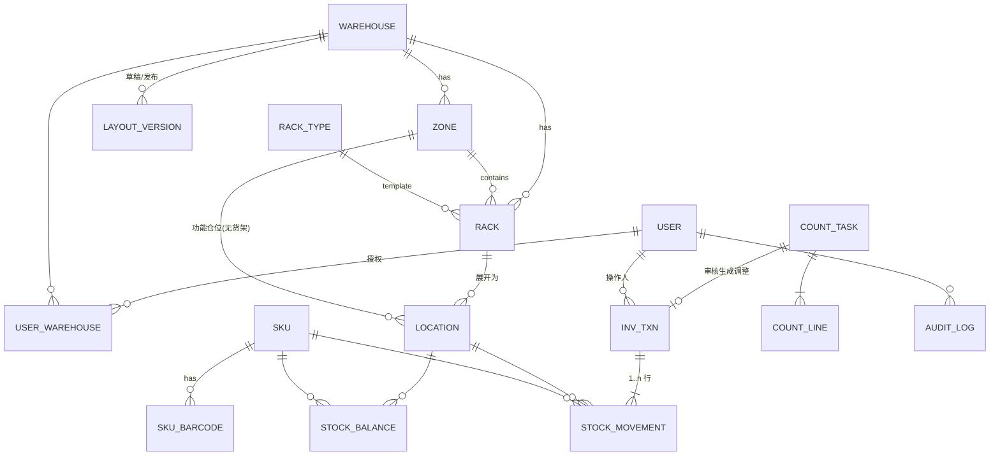

# 02 · 领域模型（Domain Model）

## 1. ERD


## 2. 层级与坐标
- 层级：`Warehouse → Zone → Rack → (Bay × Level × Position) → Location`。巷道（Aisle）是货架的属性 `aisle`（两位数），不是独立表。
- 功能仓位（收货区 `RCV`、发货区 `SHP`、待检/暂存 `QC`、调整虚拟仓位不需要）：`Location.rack_id = NULL`，属于 Zone，3D 中渲染为地面区域块。
- 坐标系：米为单位，右手系，**Y 轴向上**，原点 = 仓库平面图左下角地面；`Rack.pos_x / pos_z` 为货架**底面左前角**，`rotation_deg` 绕 Y 轴（设计器默认 90° 步进，允许任意值）。
- 仓位几何不单独存储，由 `domain.expandRack(rack, rackType)` 根据模板计算（bay 宽、层高、深度、position 均分），保证 3D 和编码一致；仅允许在仓位上覆盖 `disabled`、`max_qty`、`max_weight`。

## 3. 仓位编码规则（ADR-0008）
默认模式：`{Zone}{Aisle:2}-{Bay:2}-{Level:A}{Pos:2}`，例如 **`A03-12-C02`** = A 区 03 巷道 12 列 C 层 02 位。
- 由粗到细，字典序 ≈ 物理走动顺序；数字定宽补零；层用字母（A=最底层），与相邻数字段交替易读；只用 `[A-Z0-9-]`，不用空格、`/`、`.`、`_`（避免 Excel 转日期、扫码枪键盘布局问题）。
- 每仓库可配置模式字符串（`warehouse.location_code_pattern`），支持段：`{Zone}{Aisle:n}{Bay:n}{Level:A|n}{Pos:n}` 与字面量；创建后若已有仓位则**锁定**不可改。
- 货架码：`{Zone}{Aisle:2}-{Bay起:2}`… 简化为 `R-{Zone}{Aisle:2}-{RackNo:2}`，例如 `R-A03-01`。
- 功能仓位：`RCV-01`、`SHP-01`、`QC-01`。
- 编码在仓库内唯一；标签上额外印仓库代码防串仓。
- `pick_seq`（整数、步长 10）单独存储，用于拣货/盘点排序，不靠编码承载路径。
- **条码命名空间不冲突**：仓位码、货架码、SKU 条码共享一个"条码登记"唯一约束（同一仓库组织内不能出现相同字符串），由 `barcode_registry` 视图 + 写入时校验保证；扫码分类器 `domain.classifyScan()` 依次匹配：仓位正则/缓存 → 货架 → SKU 条码 → 未知。

## 4. 核心表（Drizzle 将据此生成迁移；字段为最小集合）
```sql
-- 账号
users(id uuid pk, username citext unique, display_name, password_hash, role text check in ('ADMIN','MANAGER','OPERATOR','VIEWER'),
      is_active bool, created_at, updated_at)
user_warehouses(user_id, warehouse_id, pk(user_id, warehouse_id))
refresh_tokens(id uuid pk, user_id, family_id uuid, token_hash, expires_at, revoked_at, device_id)

-- 仓库结构
warehouses(id uuid pk, code varchar(8) unique, name, width_m numeric, depth_m numeric, height_m numeric,
           location_code_pattern text, code_locked bool default false, published_layout_version int, created_at)
zones(id uuid pk, warehouse_id, code varchar(4), name, kind text check in ('STORAGE','RECEIVING','SHIPPING','QC'),
      polygon jsonb,  -- 地面多边形 [[x,z],...]
      color varchar(9), unique(warehouse_id, code))
rack_types(id uuid pk, name, bays int, levels int, positions_per_level int,
           bay_width_m, depth_m, level_heights_m jsonb /*每层净高数组*/, beam_m numeric, upright_m numeric,
           default_max_qty int null)
racks(id uuid pk, warehouse_id, zone_id, rack_type_id, layout_key varchar(32) /*布局文档中稳定 key*/, code varchar(16), aisle int, rack_no int,
      pos_x numeric, pos_z numeric, rotation_deg numeric, face text check in ('FRONT','BACK') /*取货面*/,
      layout_version int, is_active bool, unique(warehouse_id, code), unique(warehouse_id, layout_key))
locations(id uuid pk, warehouse_id, zone_id, rack_id null, code varchar(32), barcode varchar(64),
          bay int null, level int null, position int null, kind text /*STORAGE|RECEIVING|SHIPPING|QC*/,
          pick_seq int, max_qty int null, is_active bool default true, created_at,
          unique(warehouse_id, code), unique(warehouse_id, rack_id, bay, level, position))
layout_versions(id bigserial, warehouse_id, version int, status text check in ('DRAFT','PUBLISHED','ARCHIVED'),
                doc jsonb /*完整布局文档*/, created_by, created_at, published_at, unique(warehouse_id, version))

-- 主数据
skus(id uuid pk, code varchar(64) unique, name, spec, uom varchar(8) default 'EA', length_mm, width_mm, height_mm, weight_g,
     safety_stock int default 0, is_active bool, image_url null, created_at, updated_at)
sku_barcodes(id uuid pk, sku_id, barcode varchar(64) unique, pack_qty int default 1 check (pack_qty >= 1), is_primary bool)

-- 库存（ADR-0003）
inv_txns(id uuid pk, warehouse_id, type text check in ('INBOUND','OUTBOUND','TRANSFER','ADJUST','COUNT_ADJUST'),
         idempotency_key varchar(64) not null, request_hash char(64) not null,
         ref_no varchar(64) null, note text, status text default 'POSTED',
         user_id, device_id varchar(64), client_created_at timestamptz, created_at timestamptz default now(),
         unique(idempotency_key))
stock_movements(id bigserial pk, txn_id, warehouse_id, location_id, sku_id, lot_no varchar(32) not null default '',
                qty_delta int not null check (qty_delta <> 0), balance_after int not null,
                reason text, created_at)
stock_balances(warehouse_id, location_id, sku_id, lot_no varchar(32) not null default '',
               on_hand int not null default 0 check (on_hand >= 0),
               updated_at, version int not null default 0,
               primary key(location_id, sku_id, lot_no))
-- 只读视图：sku 总库存、仓位占用
v_sku_stock(sku_id, warehouse_id, on_hand_total, location_count)
v_location_occupancy(location_id, sku_count, qty_total, fill_ratio)

-- 盘点
count_tasks(id uuid pk, warehouse_id, code, scope jsonb /*zone/rack/location 列表*/, blind bool default true,
            status text check in ('OPEN','COUNTING','REVIEW','CLOSED','CANCELLED'), created_by, closed_txn_id null)
count_lines(id uuid pk, task_id, location_id, sku_id, lot_no, snapshot_qty int, counted_qty int null,
            counted_by, counted_at, unique(task_id, location_id, sku_id, lot_no))

-- 审计 & 告警
audit_logs(id bigserial, at timestamptz, user_id, action text, entity text, entity_id text, before jsonb, after jsonb, ip, device_id)
devices(id varchar(64) pk, name, model, user_id, last_seen_at, app_version)
```
数量统一使用**整数基本单位**（EA）；包装条码通过 `pack_qty` 换算。批次 `lot_no` 字段预留（默认 `''`），MVP UI 可隐藏。

## 5. 库存写入模型（台账 + 余额）
唯一写入口 `postTransaction(cmd)`，在**单个数据库事务**中：
1. `INSERT INTO inv_txns (... idempotency_key, request_hash)`。若唯一键冲突：
   - `request_hash` 相同 → 返回首次结果（HTTP 200，`replayed: true`）；
   - 不同 → `409 IDEMPOTENCY_KEY_REUSED`。
2. 将所有行按 `(location_id, sku_id, lot_no)` **排序**（防死锁），逐行：
   - 出库：`UPDATE stock_balances SET on_hand = on_hand - :q, version = version+1 WHERE ... AND on_hand >= :q RETURNING on_hand`；0 行 → `422 INSUFFICIENT_STOCK`（整单回滚）。
   - 入库：`INSERT ... ON CONFLICT (location_id, sku_id, lot_no) DO UPDATE SET on_hand = stock_balances.on_hand + EXCLUDED.on_hand RETURNING on_hand`。
   - 写 `stock_movements(qty_delta, balance_after)`。
3. 余额归零的行保留（便于"曾经存放"查询），定期清理 0 行（> 90 天）。
4. 事务提交后发布 `stock.changed` 事件（进程内 → SSE）。采用 `READ COMMITTED` + 行级原子更新即可，无需 SERIALIZABLE。
5. 移库 = 一个事务两行（源 −q，目标 +q）；调整 = 带原因码的 ±q。

**不变量**（测试 + 夜间对账任务验证）：
- `stock_balances.on_hand = SUM(stock_movements.qty_delta)` 按 (location, sku, lot) 分组。
- 最新一条 movement 的 `balance_after = on_hand`。
- `stock_movements`、`inv_txns` 由触发器禁止 UPDATE/DELETE；更正 = 反向交易。

## 6. 业务规则（MVP）
| 规则 | 说明 |
|---|---|
| 混放 | 默认允许一个仓位多 SKU；仓库级开关 `allow_mixed_sku` |
| 容量 | `max_qty` 设置时，入库超量返回 `422 LOCATION_CAPACITY_EXCEEDED`（可由 Manager 强制，记审计） |
| 停用仓位 | 有库存不能停用/删除；布局发布若删除有库存仓位 → 阻止发布 |
| 负库存 | 禁止（DB CHECK 兜底） |
| 盘点冻结 | 盘点任务 COUNTING 中的仓位：允许作业但在审核时以"快照 + 期间流水"计算差异（不冻结，减少停工） |
| 低库存 | SKU 总在库 < `safety_stock` 进入预警列表（查询时计算，看板显示；MVP 不发推送） |

## 7. 布局文档（layout_versions.doc）
```jsonc
{
  "schemaVersion": 1,
  "warehouse": {"widthM": 60, "depthM": 40, "heightM": 10},
  "zones": [{"code":"A","kind":"STORAGE","polygon":[[0,0],[30,0],[30,40],[0,40]],"color":"#5B8FF9"}],
  "rackTypes": [{"key":"std-4x5","bays":4,"levels":5,"positionsPerLevel":2,"bayWidthM":2.7,"depthM":1.0,
                 "levelHeightsM":[1.5,1.5,1.5,1.5,1.5],"beamM":0.1,"uprightM":0.08}],
  "racks": [{"key":"r1","zone":"A","type":"std-4x5","aisle":3,"rackNo":1,"x":2,"z":4,"rotationDeg":0,"face":"FRONT"}],
  "floorAreas": [{"zone":"RCV","locationCode":"RCV-01","polygon":[[50,0],[60,0],[60,8],[50,8]]}]
}
```
发布流程：校验（重叠检测、越界、编码冲突、被删除仓位无库存）→ 计算差异（新增/保留/停用仓位）→ 单事务写入 `racks/locations` → `published_layout_version++`。已有仓位依据 `(rack.key, bay, level, position)` 稳定匹配，保持 `location.id` 不变。
