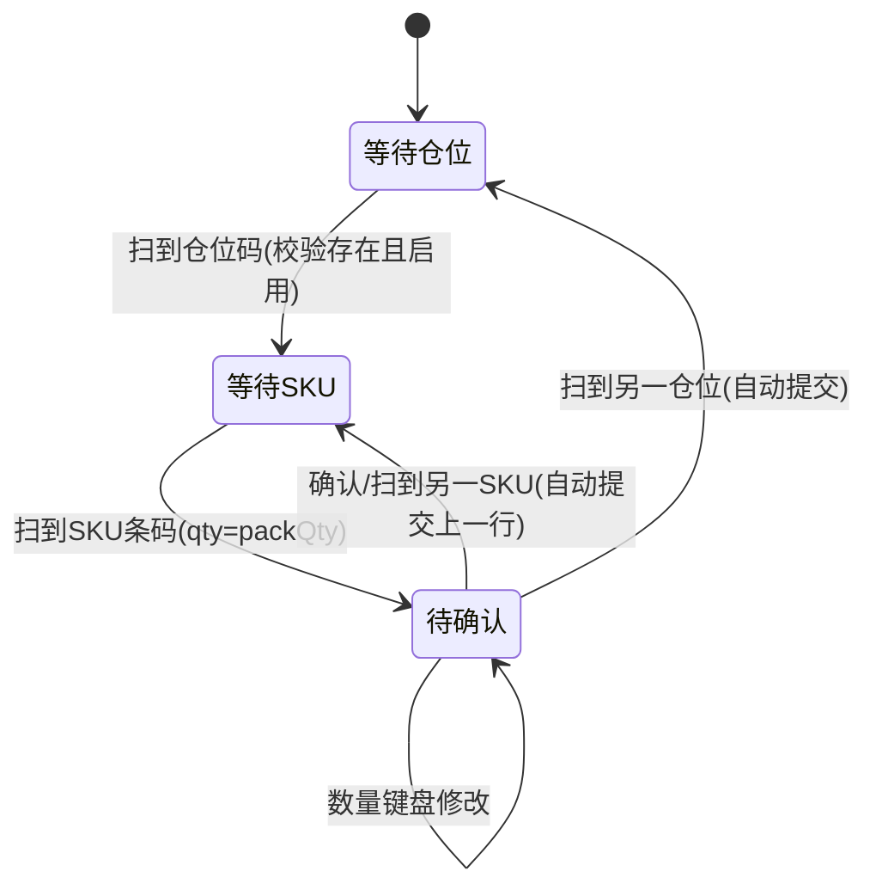

# 04 · 移动端（Android 平板 + 手机）

## 1. 形态
- **一个 APK**（`com.wms3d.app`），Capacitor 8 + React；按最短边 ≥ 600dp 判定平板布局（双栏），否则手机布局（单栏 + 底部 Tab）。
- Web 资源打包进 APK（离线可启动）；服务器地址首次配置（手输或扫"服务器配置二维码" `wms3d://config?api=https://…`）。
- 横竖屏：手机锁竖屏；平板允许横屏（左：作业面板；右：3D/明细）。

## 2. 扫码抽象（ADR-0004）
```ts
// packages/scanner
type ScanSource = 'HID' | 'SPP' | 'CAMERA' | 'MANUAL';
interface ScanEvent { text: string; source: ScanSource; symbology?: string; at: number; deviceId?: string }
interface Scanner {
  readonly source: ScanSource;
  start(): Promise<void>; stop(): Promise<void>;
  onScan(cb: (e: ScanEvent) => void): () => void;
  status(): 'idle'|'connecting'|'ready'|'error';
}
class ScanHub { register(s: Scanner); onScan(cb); /* 去重：同文本 300ms 内丢弃；规范化：trim、去 \r\n\t、去 AIM 前缀 ]C1 等 */ }
```
所有页面只订阅 `ScanHub`，不关心来源；当前页面的"期望类型"（仓位/SKU/数量）决定如何消费。

### 2.1 HID 键盘模式（多数枪默认，开箱即用）
两层实现，原生优先：
1. **原生拦截（推荐）**：插件 `@wms3d/capacitor-scanner` 在 `MainActivity.dispatchKeyEvent` 中识别来自**外接键盘类 InputDevice**（`!device.isVirtual && source & SOURCE_KEYBOARD`，可在设置里指定设备名/VendorId）的按键，按 `KeyEvent.getUnicodeChar()` 缓冲，遇 Enter/Tab 或 50ms 空闲结束 → 发 `scan` 事件，并**吞掉**这些按键，避免灌入当前输入框、触发输入法（中文输入法会拦截字母导致乱码）。
2. **JS 兜底**（PC 浏览器 USB 枪也用）：`keydown` 全局缓冲；判定规则：字符间隔 < 35ms 且长度 ≥ 4，以 Enter 结束；人工键入（间隔大）放行给输入框。
- 枪的推荐配置写进《扫码枪配置卡》（文档 + 可打印设置码页）：后缀 CR、关闭前缀、英文键盘布局、字符间延时 0。

### 2.2 SPP 串口模式（"SFP" 实为 SPP）
- 插件 Kotlin 实现：列出已配对设备（`BluetoothAdapter.bondedDevices`）→ `createRfcommSocketToServiceRecord(UUID 00001101-0000-1000-8000-00805F9B34FB)`，失败回退 `createInsecureRfcomm…` 与反射 channel 1。
- 读线程按 CR/LF 切帧（可配置终止符；无终止符时 80ms 空闲切帧），按 UTF-8/GBK 解码（可配置），通过 `notifyListeners('scan')` 送到 JS。
- 自动重连：断开后指数退避（1s→30s），状态在顶栏指示（绿/黄/红）；App 前台时保持连接，后台 5 分钟后断开省电。
- 权限：Android 12+ `BLUETOOTH_CONNECT`（只连已配对设备，不需要扫描/定位权限）；≤ 11 `BLUETOOTH`。
- 设置页：选择设备、测试扫码、终止符、编码；记住上次设备开机自动连。
- 好处：不经过输入法、无键盘弹出冲突、可识别是哪把枪；缺点：需配对和切模式 → 两种都支持，默认 HID。

### 2.3 摄像头（手机）
- 主方案：`@capacitor-mlkit/barcode-scanning@8` 的 `startScan()`（**捆绑模型**，不依赖 Google Play 服务——国内机型无 GMS 也可用），自定义取景框 UI，支持 Code128/EAN-13/QR/DataMatrix，连续扫描模式（同码 1.5s 内去重），手电筒、自动变焦。
- 兜底：WebView 内 `getUserMedia` + `zxing-wasm`（PC 浏览器/调试用）。
- 体验：扫到即震动 + "滴"声；连续作业时取景框保持打开（半屏取景 + 下半屏表单）。

## 3. 作业流程（状态机，扫码驱动）
### 3.1 入库上架（Putaway）

- **连续模式**（默认开）：扫下一个码即自动提交上一行，平板 + 枪全程 0 点击；关闭则需点"确认"（大按钮，屏幕下半部）。
- 仓位"粘滞"：连续上架同一仓位多 SKU 不必重复扫仓位。
- 来源：默认从收货区 `RCV-01` 转入（TRANSFER），或直接 INBOUND（仓库级配置，MVP 默认 INBOUND 简化）。

### 3.2 出库拣货（Pick）：同上，类型 OUTBOUND；扫 SKU 后显示该仓位当前在库（缓存值，标注"x 分钟前"），超量本地即提示。
### 3.3 移库：扫源仓位 → 扫 SKU（数量）→ 扫目标仓位 → 自动提交。
### 3.4 盘点：选任务 → 扫仓位 → 连续扫 SKU 计数（盲盘不显示账面数）→ "本仓位完成"提交 → 下一个仓位（按 pick_seq 提示）。
### 3.5 查询/定位：扫任意码 → 仓位：显示该仓位所有 SKU；SKU：显示所有仓位 + "在 3D 中查看"；货架：显示货架 3D 特写。

### UX 规则
- 字号 ≥ 18sp，主按钮 ≥ 56dp，高对比主题；成功绿闪+短震，失败红闪+长震+错误音，错误语义化中文（"该仓位已停用，请联系主管"）。
- 不依赖软键盘：数量用自绘数字键盘；HID 模式下禁止输入框自动获得焦点。
- 每个页面顶部显示：当前仓库、扫码源状态、网络状态、待上传条数。

## 4. 离线队列（ADR-0007）
- 本地存储：IndexedDB（Dexie）表 `outbox(id=idempotencyKey, payload, status: PENDING|SENDING|DONE|REJECTED, attempts, lastError, createdAt)`，以及 `cache_skus / cache_barcodes / cache_locations`（`/sync/masterdata` 增量同步，前台每 5 分钟 + 下拉刷新）。
- 流程：用户确认 → 生成 UUIDv7 → 写 outbox（先落盘再更新 UI 为"已记录"）→ 发送器串行发送（保证同设备顺序）→ 成功标 DONE；网络/5xx 退避重试；4xx 业务错误标 REJECTED 进入"异常单"页（可编辑后以**新键**重提或作废）。
- 离线允许：入库、移库、盘点提交；出库在离线时允许但显示"离线出库，联网后校验"。缓存中查不到的条码离线时允许暂存为原文（服务端解析），在线时立即提示未知条码。
- DONE 记录保留 7 天用于本机历史。登出前若有 PENDING → 阻止并提示。
- 多设备冲突由服务端原子校验裁决（库存不足即拒绝），不做客户端合并。

## 5. 3D 查看器（移动端性能预算）
| 指标 | 预算 |
|---|---|
| Draw calls | ≤ 60 |
| 三角形 | ≤ 150k |
| 帧率 | ≥ 30 FPS（中端机），静止时按需渲染（`frameloop="demand"`）≈ 0 GPU |
| 像素比 | `dpr = min(devicePixelRatio, 1.5)`，交互中降到 1 |
| 内存 | JS 堆 ≤ 150MB；无大纹理（≤ 2 张 512² 图集） |
| 首屏 | 场景数据缓存 + ETag，≤ 3s |
详见 06 文档。WebView 需开启硬件加速（默认）；低端机降级为 2D 平面图（自动检测：首 2 秒平均 FPS < 20 提示切换）。

## 6. 原生工程要点
- `minSdk 24 / targetSdk 36`，JDK 21，AGP 8.13，Gradle 8.14；ABI：arm64-v8a + armeabi-v7a。
- 插件目录 `native/capacitor-scanner`（含 `android/` Kotlin 源码 + TS 定义 + web mock 实现，web mock 允许在浏览器用键盘模拟 SPP 扫码，便于 e2e）。
- 安全存储：refresh token 用 Android Keystore 包装（`@capacitor/preferences` + 插件内 AES-GCM，或采用社区 secure-storage 插件，M3 时评估）。
- 构建：`pnpm --filter mobile build && npx cap sync android && ./gradlew assembleDebug|assembleRelease`；release 签名 keystore 不入库（`.env` + CI secret）。
