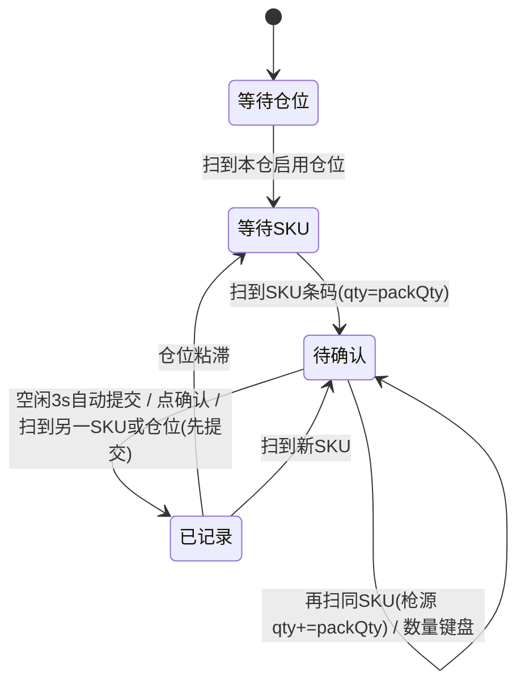

# 04 · 移动端（Android 平板 + 手机）

> v2（2026-11-12）：HID 拦截改 pre-IME、设备白名单与阈值、SPP 权限与重连、相机瞄准框 + 双帧确认、去重 vs 累加、连续模式空闲提交/撤销/打断式拒绝、outbox 改 SQLite、CORS/证书/SSE、WebView 版本门槛、edge-to-edge。
> **v2.1**（2026-11-12，R2）：相机再触发改为时间间隔 + 坐标 dpr 换算（M-N5）、应用内字母数字键盘（M-N6）、真机验证改为发布门禁（M-N7）、华为 WebView 门槛与 ES5 错误页（M-N8）、换班代交（M-N9/B-N6）、倒计时与小键盘（M-N10）、拒绝遮罩期间的扫码（M-N11）、包住 content 根布局（M-N16）、WAITING_STOCK 仅离线单（B-N5）、盘点只阻塞本仓位单据（B-N12）、SPKI 校验时机（M-N19）。

## 1. 形态与网络
- **一个 APK**（`com.wms3d.app`），Capacitor 8 + React 19 + antd-mobile 5；最短边 ≥ 600dp 为平板布局（双栏），否则手机布局。
- Web 资源打包进 APK；`capacitor.config.ts`：`android.minWebViewVersion: 99`、`android.minHuaweiWebViewVersion`（占位 12，M3 实测校准）、`server.errorPath: 'webview-too-old.html'`（`public/` 下的**独立 ES5 页面**，不经 Vite 转译。v2.2，R3：Capacitor 在**任何主框架加载错误**时都会加载 errorPath，因此页面按 `?missing=` 区分两种文案——有参数显示“WebView 过低”，无参数显示“页面加载失败”+“重试”按钮 `location.replace('/')`）。运行时特性检测两层（v2.2，R3）：① `index.html` 中模块脚本之前的**内联 ES5 classic script**（ES 模块、`Array.prototype.at`、`structuredClone`、`crypto.getRandomValues`、IndexedDB），语法不兼容的 ROM 也能跳到错误页；② `main.tsx` 的 `runtime-check.ts` 作为第二层。WebGL2 缺失只降级 2D（§6）。M0a 已实现，Vite `build.target = 'es2020'`；不使用 `@vitejs/plugin-legacy`（避免大量 polyfill，以版本门槛代替）。
- 网络：WebView `fetch` 直连 API（跨域，见 03 §1.1 CORS）；SSE 用自研 `packages/api-client/src/sse.ts`（fetch 流 + eventsource-parser）带 Bearer（03 §6）。
- **服务器配置**：手输或扫配置二维码 `wms3d://config?api=https://wms.example.com&pin=sha256/<SPKI>`；扫码后**显示主机名与证书指纹，要求用户确认**；更换服务器必须先清空本地数据（且 outbox 为空）（D35/M28）。
- **证书信任（两条部署路径，D35/M3b）**：
  1. **推荐**：真实域名 + Caddy ACME（内网用 DNS-01 签发），App 无需特殊处理。
  2. **内部 CA**：`network_security_config.xml` 的 `base-config` 信任 `system` + `user` 锚点（这是专用作业 App，风险可接受并写入安全说明）；用户按手册在系统设置中安装 CA；配置二维码携带 SPKI 指纹，原生插件 `verifyServerPin(host, pin)`（`HttpsURLConnection` 读取证书链）在**首次配置和每次启动**时校验，不符则拒绝连接并提示（WebView 自身网络栈不支持自定义 TrustManager，所以用"启动校验 + 系统信任"组合）。v2.1（M-N19）明确：SPKI **只在启动/配置时校验**，运行期 WebView 请求只依赖系统 + 用户锚点；证书轮换时**保持私钥不变**（SPKI 不变）或先下发含新旧两个指纹的配置码（见 08 运维手册）。WebView 信任用户锚点的行为本机无法测试（无设备/模拟器），列入 M6 现场验证清单。
  release 构建禁止 cleartext；debug 构建允许局域网 http。
- **edge-to-edge**（targetSdk 36 强制，M27）：用 Capacitor 8 系统栏/insets 配置，CSS 全面使用 `env(safe-area-inset-*)`；底部主按钮与 Tab 留出导航条区域。
- 手机锁竖屏；平板允许横屏（左作业、右 3D/明细）。

## 2. 扫码抽象（ADR-0004 v2）
```ts
// packages/scanner
type ScanSource = 'HID' | 'SPP' | 'CAMERA' | 'MANUAL';
interface ScanEvent { text: string; source: ScanSource; symbology?: string; at: number; deviceKey?: string }
interface Scanner { readonly source: ScanSource; start(): Promise<void>; stop(): Promise<void>;
                    onScan(cb: (e: ScanEvent) => void): () => void; status(): 'idle'|'connecting'|'ready'|'error' }
class ScanHub { register(s: Scanner); onScan(cb); /* 规范化：trim、去 \r\n\t、去 AIM 前缀 ]C1 等；去重按来源配置（§2.4） */ }
```

### 2.1 HID 键盘模式（M2/M10）
**拦截点在 pre-IME**：`apps/mobile/android/app/src/main/java/.../MainActivity` 中用自定义 `ScannerInterceptLayout extends FrameLayout` 包住 **`android.R.id.content` 下的根布局**（v2.1 M-N16：不改变 WebView 的父节点，Capacitor 的 insets 处理与 ML Kit 把 PreviewView 插到 WebView 父节点的逻辑都依赖原有层级；M0a 已实现），重写 `dispatchKeyEventPreIme()`；该钩子沿焦点链先于输入法收到物理按键，因此即使焦点在搜狗/百度拼音的输入框里，扫码字符也不会进入拼音组字。`Activity.dispatchKeyEvent` 保留为第二道防线。插件（`native/capacitor-scanner`）只提供逻辑类 `HidWedgeBuffer` 与 JS 事件桥；**Hook 代码必须写在 App 的 MainActivity**（插件 API 不能自行挂到 Activity 的 pre-IME 管线）——WS-C 同时拥有两处目录。
- **设备识别**：只拦截 `KEYBOARD_TYPE_ALPHABETIC` 且在**白名单**中的设备；白名单在设置页"测试扫码"时自动记录 `InputDevice.descriptor` + VID/PID。非白名单设备（音量键 gpio-keys、键盘皮套、USB 键盘）全部放行。
- 只缓冲可打印字符、Enter、Tab；其他键放行。字符用 `event.getUnicodeChar(event.getMetaState())`（正确处理 Shift）。部分扫描枪一次发出 `ACTION_MULTIPLE` + `getCharacters()`，M3 一并处理（M-N16）。
- 结束条件：终止符（Enter/Tab）为主；**150ms 空闲**为兜底；缓冲上限 256 字符。
- **JS 兜底**（PC 浏览器 USB 枪、未白名单时）：判定"平均字符间隔 < 30ms 且最大间隔 < 120ms 且长度 ≥ 4，以 Enter 结束"，否则放行给输入框。
- 软键盘（v2.1，M-N6 部分采纳）：接 HID 枪后 Android 默认隐藏软键盘，且 `SHOW_FORCED` 已废弃、在物理键盘连接时不可靠，**不再依赖**。登录、搜索等文字输入使用 `packages/ui` 的**应用内字母数字键盘**（大按键，数字/字母/常用符号）；设置页提供跳转 `Settings.ACTION_HARD_KEYBOARD_SETTINGS` 的快捷入口与图文指引（开启"物理键盘连接时显示屏幕键盘"）。扫工牌登录推迟到 v1.1。
- 扫码作业页坚持"无可编辑焦点"（数量用自绘键盘）。
- 枪配置卡：后缀 CR、无前缀、美式键盘布局、字符间延时 0、关闭自动休眠或调长。

### 2.2 SPP 串口模式（M8/M9）
- 权限（Manifest）：`BLUETOOTH`、`BLUETOOTH_ADMIN`（`maxSdkVersion=30`）、`BLUETOOTH_CONNECT`、`BLUETOOTH_SCAN`（`usesPermissionFlags="neverForLocation"`）。运行时用 Capacitor 插件 `@Permission(alias=...)` + `requestPermissionForAlias`；拒绝/“不再询问”时显示说明并引导到系统设置。
- 连接：只连**已配对**设备 → 若有 SCAN 权限先 `cancelDiscovery()`（try/catch）→ `createRfcommSocketToServiceRecord(SPP UUID 00001101-0000-1000-8000-00805F9B34FB)` → 失败回退 `createInsecureRfcommSocketToServiceRecord` → 再失败且设置开关 `allowReflectionFallback` 打开时才用反射 `createRfcommSocket(1)`（非 SDK 接口，记日志，真机清单标风险）。
- 帧切分：可配置终止符（默认 CR/LF/CRLF，**空帧丢弃**）；跨 `read()` 的半帧缓冲；无终止符时 80ms 空闲切帧；缓冲上限 512B；编码 UTF-8/GBK 可选。
- 重连（适配枪休眠）：前台退避 0.5s→**上限 3s**；注册 `ACTION_ACL_CONNECTED/ACL_DISCONNECTED` 广播，目标枪一出现立即连接；`handleOnResume` 立即重连；后台 5 分钟后断开省电，回前台立刻重连。断连时顶栏**醒目变红 + 提示音**。
- 设置页：选择设备、测试扫码、终止符、编码、记住设备自动连接。

### 2.3 摄像头（M11/M12）
- `@capacitor-mlkit/barcode-scanning@8.2.2` 的 **`startScan()`**（捆绑模型 `com.google.mlkit:barcode-scanning`，无需 GMS）；**不使用 `scan()`，不加 `barcode_ui` meta-data**。手电筒用 `@capawesome/capacitor-torch@8`。
- `formats` 限定 Code128 / EAN-13 / EAN-8 / UPC-A / QR / DataMatrix。
- **瞄准框 + 双次确认**：`cornerPoints` 是物理像素，**先除以 `devicePixelRatio`** 再与 CSS 坐标的瞄准框比较（v2.1 M-N5），只接受**中心点落在瞄准框内**的码；框内多个码取离中心最近者；**连续 2 次 `barcodesScanned` 事件读到同一码**且中心都在框内才算有效（插件事件不是逐帧的）；瞄准框中央画十字准星。
- 首次识别延迟：插件内部要求约 10 次一致检测（10-vote）才上报，预算 **约 0.5s**；若实测偏慢，可用 `patch-package` 降低阈值（M3 评估）。
- **渲染模型**：`startScan` 把相机画在 WebView 下方，需要 DOM 透明。作业页布局固定为"**上半屏透明区**（只有瞄准框/状态）+ **下半屏不透明表单**"；进入扫码时给 `html/body/#root` 及上半区祖先加 `barcode-scanner-active` 透明类；扫码页禁止全屏 Modal 与页面转场动画；3D canvas 不与相机同屏。透明度用 Playwright DOM 截图测试覆盖（v2.1 M-N7，取代模拟器 spike），真机效果进 M6 现场验证。
- 再触发规则（v2.1，M-N5）：同一码在事件流中**消失 ≥ 400ms**（期间没有任何包含它且中心在框内的事件）后才能再次触发——事件不是逐帧的，不能按"5 帧"计数。
- 相机来源下的"计数"场景（同 SKU 多件、盘点）默认"**扫一次 + 数量键盘**"，UI 明确提示（M29）。

### 2.4 去重 vs 数量累加（M4）
| 来源 | 去重规则 | 同 SKU 累加 |
|---|---|---|
| HID / SPP | 不做时间去重；仅丢弃 < 80ms 的完全相同帧（枪一次扳机一帧） | 再扫同 SKU → qty += packQty |
| CAMERA | 离框再触发（§2.3） | 默认关闭，用数量键盘；可在设置打开 |
| MANUAL | 无 | — |
参数在 `packages/scanner/config.ts`，均有单测。

### 2.5 反馈（M26）
插件 `feedback({type: 'ok'|'warn'|'error'})`：`SoundPool` 预载 3 个短音 + `@capacitor/haptics`。**成功音只在业务校验通过后播放**（枪自身蜂鸣表示"读到"，App 成功音表示"系统接受"）。

## 3. 作业流程（扫码驱动状态机）
### 3.1 入库上架（Putaway）

- **连续模式**（默认开，M5）：待确认行显示**倒计时条（默认 3s，可配 1–10s）**，到时自动提交；扫下一个码也会立即提交上一行；作业结束无需额外操作。v2.1（M-N10）：**数量键盘打开时倒计时暂停**，关闭后重新计时；出库数量超过缓存在库时**暂停自动提交**，必须手动确认。
- **撤销上一笔**（大按钮，提交后 10s 内可见）：未发送 → 直接从 outbox 删除；已发送 → 调用 `/inventory/transactions/:id/reverse`（OPERATOR 本人 10 分钟内允许，见 02 §6.4）。
- **两种勾**：灰勾 = 已落本机 outbox；绿勾 = 服务端已确认。
- **打断式拒绝**：服务端返回业务拒绝时（库存不足超过重试期、仓位停用、超容量、越权等），**红色全屏条 + 错误音 + 长震**，必须点"知道了"才能继续扫；遮罩期间的扫码**全部丢弃并播放错误音**（v2.1 M-N11，避免误把下一件商品记到上一行）；顶栏异常单徽标计数。
- 来源：MVP 默认 INBOUND（仓库可配置为从 RCV-01 TRANSFER）。

### 3.2 出库拣货：同上，类型 OUTBOUND；显示缓存在库（标注"x 分钟前"），超量本地即提示。
### 3.3 移库：扫源仓位 → 扫 SKU（数量）→ 扫目标仓位 → 自动提交。
### 3.4 盘点：选任务 → 扫仓位 → 计数（枪源连续扫累加；相机源扫一次 + 键盘）→ "本仓位完成"提交（未扫到的 SKU 计 0，提交前确认清单）→ 下一仓位（按 pick_seq）。提交前若本机 outbox 中有**涉及该仓位**的待传单据 → 阻止并先同步（v2.1 B-N12，02 §8）；其他仓位的待传单据不阻塞。
### 3.5 查询/定位：扫任意码 → 仓位明细 / SKU 所在仓位 + "在 3D 中查看" / 货架特写。
### 3.6 标签核对（M33，M4.5 交付，M4 提供 3D 组件）：连续扫仓位标签，3D 中逐个点亮，未扫到的仓位保持灰色，输出漏贴/错贴清单。

### 3.7 每个状态对"意外码"的处理（M29，组件测试覆盖）
| 当前状态 \ 扫到 | 仓位（本仓） | 停用仓位 | 货架码 | SKU | 其他仓库码 | 未知 |
|---|---|---|---|---|---|---|
| 等待仓位 | → 等待SKU | 错误：已停用 | 提示"请扫仓位而非货架" | 提示"请先扫仓位" | 错误：WRONG_WAREHOUSE | 错误：未知条码 |
| 等待SKU | 切换仓位 | 错误 | 提示 | → 待确认 | 错误 | 错误（在线）/ 暂存原文（离线） |
| 待确认 | 提交后切换仓位 | 提交后报错 | 提示（不提交） | 同 SKU 累加 / 异 SKU 提交后新行 | 错误（不提交） | 错误（不提交） |
| 移库-等待目标 | → 提交 | 错误 | 提示 | 提示"请扫目标仓位" | 错误 | 错误 |

### UX 规则
字号 ≥ 18sp，主按钮 ≥ 56dp；高对比主题；顶部状态栏：仓库、扫码源状态、网络、待上传/异常数；不依赖软键盘。

## 4. 本地存储
| 数据 | 存储 | 说明 |
|---|---|---|
| **outbox（离线账本）** | **SQLite**（`@capacitor-community/sqlite@8`，App 私有目录，D/M6） | 不受"清除缓存"/WebView 存储回收影响 |
| 主数据缓存（SKU/条码/仓位码）、TwinModel 缓存 | IndexedDB（Dexie 4） | 可重建；启动调用 `navigator.storage.persist()` |
| refresh token | 插件 AES-GCM + Android Keystore | |
设置页提供"**导出待传队列**（JSON 文件）"应急按钮。

## 5. 离线队列（ADR-0007 v2）
- 表 `outbox(id = idempotencyKey, warehouseId, operatorUserId, type, payload, status, attempts, nextAttemptAt, lastError, createdAt, createdOffline, sentAt)`；状态：`PENDING | SENDING | DONE | WAITING_STOCK | BLOCKED_AUTH | REJECTED | CANCELLED`。
- 流程：确认 → 生成 UUIDv7 → **先写 SQLite**，再更新 UI（灰勾）→ 发送器串行发送（同设备顺序）→ 响应处理见 03 §3.1。
- **拒绝不阻塞队列**；同仓位 + SKU 的后续单标"可能受影响"。
- `WAITING_STOCK`：**只适用于 `createdOffline=true` 的单据**（v2.1 B-N5）：同键每 2 分钟重试、最长 24h（跨设备乱序时货其实已上架，稍后即可成功，D6）。在线创建的单据收到库存不足立即打断，提供"稍后自动重试"按钮。
- **换班代交**（v2.1，B-N6/M-N9；替代 v2 的"原操作员重新登录"）：A 可以带着待传单据登出，B 登录后发送器用 **B 的令牌**继续发送 A 的单据（`performedBy`=A 不变），服务端按 `device_sessions` 校验（02 §6.6）。**不采纳**"设备上保存每个用户的 refresh token"（M-N9 原建议）：多份长期凭据增加泄露面，且需要后台多身份切换。
- `BLOCKED_AUTH`：仅当设备上**没有任何有效登录**（或当前用户需改密，B-N14）时暂停；任意用户登录后继续。
- 心跳：前台每 60s `POST /devices/heartbeat` 上报 `pendingOutbox`，后台显示"全仓待同步 N 条"。
- 主数据：首次登录分页全量同步并显示进度，**首次同步完成前禁止离线作业**；之后前台每 5 分钟增量 + 每日 digest 比对（03 §5）。
- 离线时允许：入库、移库、出库（提示"离线出库，联网后校验"）；缓存查不到的条码离线暂存原文。
- DONE 保留 7 天；**登出不要求 outbox 为空**（换班代交）；换服务器前 outbox 必须为空（可导出后强制清空，需 MANAGER 口令）。
- 异常单页：每单给出处理选项——重试（新键）、改仓位后重提、作废、"找主管调整"（主管 ADJUST 须以异常单号为 `refNo`）。

## 6. 3D 查看器（移动端）
性能预算与分档见 06 §8。移动端特有：
- 3D 面板不可见（Tab 切换、`visibilitychange`、IntersectionObserver）时停止渲染；处理 `webglcontextlost/restored` 重建资源（M21）。
- 启动前检测 WebGL2，不支持直接用 2D 平面图（M13）；启动时 2s 强制连续渲染基准测 p50 帧时间 > 50ms 则建议降级（M22）。
- 触控（M25）：canvas `touch-action: none`，视口 `user-scalable=no`；默认**单指平移、双指缩放+旋转**；点击判定移动 < 8px 且 < 250ms。

## 7. 原生工程要点
- `minSdk 24 / targetSdk 36 / compileSdk 36`，JDK 21，AGP 8.13，Gradle 8.14.3（M0a 已在本机 spike 通过）；ABI arm64-v8a + armeabi-v7a。
- 目录：`native/capacitor-scanner`（Kotlin：HidWedgeBuffer、SPP、feedback、verifyServerPin、showSoftInput、Keystore 加密；TS 定义；web mock 用于浏览器 e2e）；`apps/mobile/android`（MainActivity pre-IME Hook、network_security_config、Manifest 权限）。
- 构建：`pnpm --filter mobile build && npx cap sync android && ./gradlew assembleDebug|assembleRelease`；release keystore 不入库。
- **真机验证策略（v2.1，M-N7）**：本机没有平板/扫描枪/模拟器（无 KVM），开发期以 Robolectric 测 `dispatchKeyEventPreIme` 拦截、纯 JVM 单测测 SPP 帧切分、Playwright 截图测相机透明区、debug 包提供"把软键盘视为白名单设备"开关做手工联调；D3 交付物 = web mock 演示视频 + 测试报告。**M6 发布门禁**：真机现场验证 + 30 分钟现场验收脚本（10 §M6）；HID 拦截失败的兜底方案 = 改用 SPP 模式或作业页"无焦点"模式。需要 leo 提供 1 台平板 + 1 把 HID/SPP 扫描枪（依赖项）。
- 真机清单（每个里程碑）：HID 枪（含"焦点在中文输入法搜索框时扫码"）、SPP 枪（休眠唤醒首枪）、相机（密集标签误读）、无 GMS 国产机 ≥ 1 台（华为/荣耀/小米国内版）、手势导航机型底部按钮、后台恢复后 3D 与 SPP。
