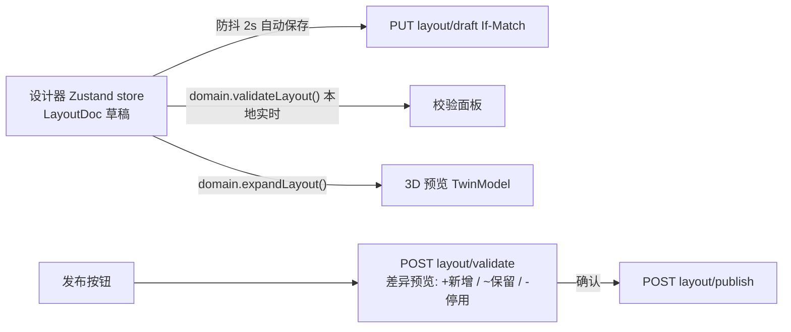

# 05 · PC 管理后台与布局设计器

## 1. 信息架构
```
登录
├─ 看板 Dashboard（今日入/出库量、仓位利用率、低库存 Top10、最近异常）
├─ 库存
│   ├─ 库存查询（按 SKU / 仓位 / 库区，导出 CSV）
│   ├─ 流水台账（筛选：时间、类型、SKU、仓位、操作人）
│   ├─ 交易单（明细、来源设备）
│   ├─ 库存调整（MANAGER，需原因）/ 移库（PC 端也可操作）
│   └─ 低库存预警
├─ 盘点（任务列表、创建、进度、差异审核、关闭）
├─ 3D 孪生（与移动端同一查看器，大屏模式）
├─ 主数据
│   ├─ SKU（列表、编辑、多条码、CSV 导入向导：上传→预检→确认）
│   └─ 仓位（列表、启停、容量、pick_seq 批量编辑）
├─ 仓库设计
│   ├─ 仓库 & 库区
│   ├─ 货架模板 Rack Types
│   └─ 布局设计器（草稿 / 校验 / 发布 / 历史版本）
├─ 标签打印（选择对象 → 模板 → 预览 PDF → 打印/下载）
└─ 系统（用户与角色、设备、审计日志、系统设置）
```
技术：React 19 + AntD 5（ProTable 风格表格自写轻封装，避免引入 ProComponents 全家桶）、TanStack Query、React Router、Zustand（设计器本地状态）、i18n（zh-CN 默认，en 预留）。

## 2. 布局设计器（核心）
### 2.1 交互
- **画布**：react-konva 2D 俯视图，网格 0.1m/1m 双层，缩放平移（滚轮/拖拽空白），标尺显示米。
- **工具栏**：选择、绘制库区多边形、放置货架（从模板拖入）、地面区（收货/发货）、测距、撤销/重做（命令栈，≥ 100 步）。
- **货架操作**：拖动（吸附网格与邻近货架边缘，Shift 关闭吸附）、旋转 90°（R 键）/任意角度（属性面板）、复制/阵列（"按间距 X 复制 N 个"——一次生成整条巷道）、批量设置 aisle/rackNo（按选中顺序自动编号）。
- **属性面板**：货架编码预览、模板参数、位置/角度、取货面；选中仓位（双击货架进入"立面视图"）可设置停用/容量。
- **校验面板**（实时）：货架重叠（OBB 相交）、超出仓库边界、巷道宽度 < 阈值（默认 1.2m，警告）、编码重复、删除了有库存的仓位（错误）。
- **3D 预览**：右侧可切换分屏，复用 `packages/twin3d`，与 2D 选中联动。
- **立面视图**：选中货架展示 bays × levels 网格，显示每个仓位编码与库存（已发布时），可多选批量停用/打印标签。

### 2.2 数据流

- 校验与仓位展开逻辑在 `packages/domain` 中**前后端共享**（同一函数），服务端发布时再次执行权威校验。
- 草稿乐观锁：两名管理员同时编辑 → 第二个保存得到 412，提示"重新加载或另存为新草稿"。
- 历史版本只读查看、可"基于此版本创建草稿"（回滚）。

### 2.3 模板（Rack Type）编辑
表单 + 实时立面小预览：列数、层数、每层位数、列宽、深度、各层净高、横梁/立柱尺寸、默认容量。常用预设：重型托盘架（2.7m×1.0m×4 层）、中型层板架（1.5m×0.6m×5 层×3 位）、轻型货架（1.0m×0.5m×5 层×4 位）。

## 3. 其他页面要点
- **SKU CSV 导入**：模板列 `code,name,spec,uom,barcode,pack_qty,safety_stock,length_mm,width_mm,height_mm,weight_g`；同一 SKU 多条码用多行；预检返回逐行错误（重复、条码冲突、格式），确认后单事务 upsert；≤ 5 万行，流式解析（papaparse 前端预览 + 服务端 csv-parse 权威）。
- **库存查询**：SKU 视图（总量 + 展开仓位明细）/ 仓位视图；每行"在 3D 中定位"跳转。
- **USB 扫码枪**在 PC 也可用于搜索框（JS HID 兜底层）。
