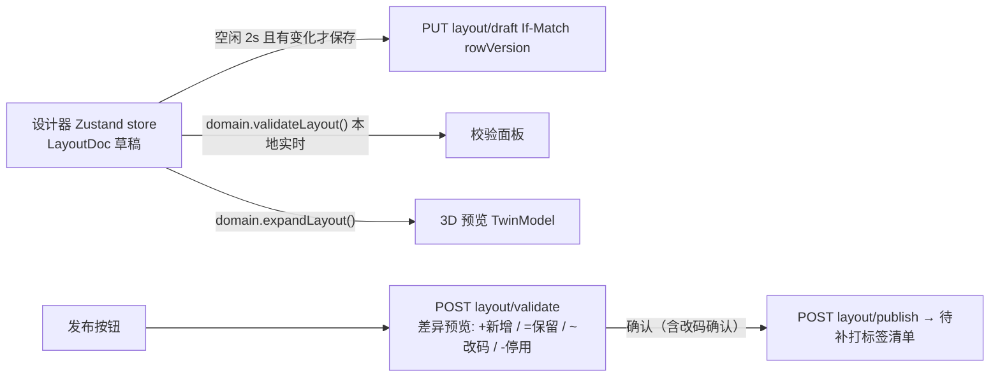

# 05 · PC 管理后台与布局设计器

## 1. 信息架构
```
登录
├─ 看板 Dashboard（今日入/出库量、仓位利用率、低库存 Top10、最近异常）
├─ 库存
│   ├─ 库存查询（按 SKU / 仓位 / 库区，导出 CSV）
│   ├─ 流水台账（筛选：时间、类型、SKU、仓位、操作人）
│   ├─ 交易单（明细、来源设备）
│   ├─ 库存调整（MANAGER，需原因）/ 移库（PC 端也可操作）
│   └─ 低库存预警
├─ 盘点（任务列表、创建、进度、差异审核、关闭）
├─ 3D 孪生（与移动端同一查看器，大屏模式）
├─ 主数据
│   ├─ SKU（列表、编辑、多条码、CSV 导入向导：上传→预检→确认）
│   └─ 仓位（列表、启停、容量、pick_seq 批量编辑）
├─ 仓库设计
│   ├─ 仓库设置（编码模式、条码前缀、混放、时区）
│   ├─ 货架模板 Rack Types
│   └─ 布局设计器（草稿 / 校验 / 发布 / 历史版本）
├─ 标签打印（选择对象 → 模板 → 预览 PDF → 打印/下载）
└─ 系统（用户与角色、设备、审计日志、系统设置）
```
技术：React 19.3 + **AntD 6.7**（表格自写轻封装，不引入 ProComponents）、TanStack Query、React Router、Zustand（设计器本地状态）、i18n（zh-CN 默认）。

> v2 变化：库区/货架只能通过布局草稿编辑（布局文档是唯一真相源，02 §4）；MVP 仅 90° 步进旋转；阵列复制自动生成巷道 bay 编号；立面视图的停用/容量直接写 `locations`；3D 预览在 M4.5 接入 twin3d。

## 2. 布局设计器（核心）
### 2.1 交互
- **画布**：react-konva 2D 俯视图，**遵守 02 §2 坐标约定**（原点左上，u→x、v→z 不翻转，旋转俯视顺时针为正），网格 0.1m/1m 双层，缩放平移，标尺显示米。
- **工具栏**：选择、绘制库区多边形、放置货架（从模板拖入）、地面区（收货/发货）、测距、撤销/重做（命令栈，≥ 100 步）。
- **货架操作**：拖动（吸附网格与邻近货架边缘，Shift 关闭吸附）、旋转 90°（R 键；MVP 只允许 0/90/180/270，任意角度字段保留到后续版本）、阵列复制（"沿巷道按间距复制 N 个"，自动设置 `aisle/rackNo/bayStart`：**按巷道行进方向排序**（水平巷道 +X、竖直巷道 +Z），上一货架 `bayStart + 2·bays`，左侧奇数右侧偶数；`side` 由旋转推导，v2.1 B-N1/M-N1）、批量设置 aisle。画布在巷道上绘制行进方向箭头，并在两侧取货面线间距 < 1.2m 时标黄（02 §3.1 几何校验）。
- **属性面板**：货架码与仓位码范围预览（如 `A03-01…07-D02`）、模板参数（按值快照）、位置/角度、aisle/bayStart（side 只读，由旋转推导）；取货面固定为局部前面（需要反向就旋转 180°）。
- **校验面板**（实时，`domain.validateLayout` 前后端共享）：货架重叠（90° 步进下即 AABB 相交）、越界、巷道宽度 < 1.2m（警告）、bay 区间重叠/奇偶错误、编码重复、编码长度超标签容量、删除有库存仓位（错误，发布时权威校验）、有库存仓位改码（需确认）。
- **3D 预览**：右侧分屏，复用 `packages/twin3d` 的 `TwinView`，与 2D 选中联动（M4.5 已接入）。
- **立面视图**（2D 网格）：选中货架展示 bays × levels，显示仓位编码与库存（已发布时）；多选批量停用/容量（**运行时属性，直接 `PATCH /warehouses/:id/locations/bulk`，不进布局版本**）/打印标签。

### 2.2 数据流

- 校验与仓位展开逻辑在 `packages/domain` 中**前后端共享**（同一函数），服务端发布时再次执行权威校验。
- **权限**（与契约 `publishLayout.roles`、08 §1 一致）：ADMIN 与 MANAGER 可编辑草稿、校验；**发布仅 ADMIN**。
- 草稿乐观锁：每仓库只有一个草稿（`row_version`）；保存得到 412 时，用本地副本与服务器版本做三方对比提示（保留我的 / 采用服务器 / 导出我的副本后重载），不再提供"另存为新草稿"。
- 历史版本只读查看，可"基于此版本创建草稿"（回滚；已有草稿时需先丢弃）。

### 2.3 模板（Rack Type）编辑
表单 + 实时立面小预览：列数、层数、每层位数、列宽、深度、各层净高、横梁/立柱尺寸、默认容量。常用预设：重型托盘架（2.7m×1.0m×4 层）、中型层板架（1.5m×0.6m×5 层×3 位）、轻型货架（1.0m×0.5m×5 层×4 位）。

## 3. 其他页面要点
- **SKU CSV 导入**：模板列 `code,name,spec,uom,barcode,pack_qty,safety_stock,length_mm,width_mm,height_mm,weight_g`；同一 SKU 多条码用多行；预检返回逐行错误（重复、条码冲突、格式），确认后**每 1000 行一个事务**分批 upsert（v2.1 B-N7：单个大事务会超过 `transaction_timeout` 并让增量同步漏行；按 code upsert 天然幂等，失败可从断点重跑）；≤ 5 万行，流式解析（papaparse 前端预览 + 服务端 csv-parse 权威）。**更新已有 SKU 时，CSV 缺列或该单元格为空则保留库中原值**（不把安全库存/尺寸/单位冲成默认值）；新建 SKU 缺省 `safety_stock=0`、`uom=EA`，尺寸与规格为空。表头仍必须含 `code` 与 `name`。
- **库存查询**：SKU 视图（总量 + 展开仓位明细）/ 仓位视图；每行"在 3D 中定位"跳转。
- **USB 扫码枪**在 PC 也可用于搜索框（JS HID 兜底层）。
