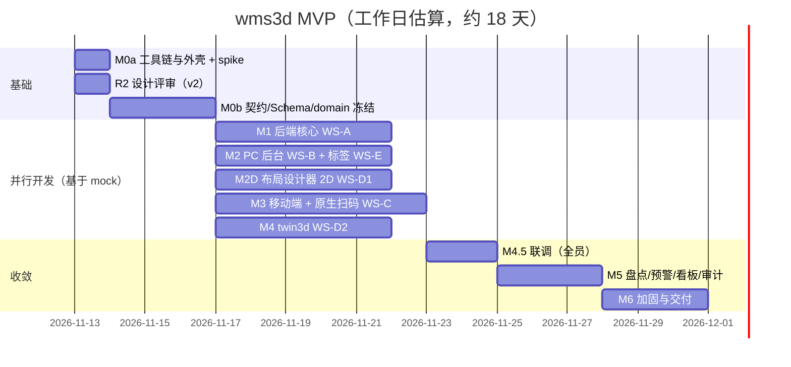

# 10 · 开发计划

> v2（2026-11-12）：M0 拆为 M0a/M0b；设计器（WS-D1）与 twin3d（WS-D2）拆开，3D 预览在 twin3d 之后接线；新增 2 天联调里程碑 M4.5；修正 M5/M6 依赖；新增"单机多 Agent 隔离"与原生部署路径。总工期约 18 个工作日。
> **v2.1**（2026-11-12，R2）：WS-A 拆为 WS-A1（主数据/布局/标签端点）与 WS-A2（库存/盘点/同步/孪生），n=8（B-N11）；`apps/api/src/db/**` 冻结后归 Lead；依赖预装与契约请求通道（B-N9）；合并队列移出 git、M0b 起 Lead 在 worktree 开发、main 只做合并（B-N10）；M3 真机验证改为 M6 发布门禁（M-N7）；M0a 完成记录。
> **v2.2**（2026-11-12，R3）：契约 v1 冻结（tag `contract-v1`）；M0b 完成记录见 §M0b；工作流简报 `docs/workstreams/`；ownership 与模块目录按 contracts tag 对齐。

## 1. 组织与所有权
| 角色/WS | 名称 | 独占目录（写权限） |
|---|---|---|
| Lead（Noa） | 契约、集成、评审、合并 | `packages/contracts/**`、`packages/api-client/**`（客户端 + mock，随契约维护）、`packages/domain/src/{demo,__fixtures__}/**`、`apps/api/src/{modules/index.ts,modules/types.ts,test}/**`、`packages/domain/src/index.ts`（公共签名）、根配置、`pnpm-lock.yaml`、`docs/**`（`docs/contract-requests/**` 除外）、**`apps/api/src/db/**`**（schema、迁移、`locks.ts`；契约冻结后归 Lead，v2.1 B-N11） |
| WS-A1 | 后端：主数据与布局 | `apps/api/src/{app.ts,app.test.ts,main.ts,plugins,lib}/**`、`apps/api/src/modules/{ops,auth,users,warehouses,layout,locations,skus,scan,labels}/**`（v2.2：模块 = contracts tag；设备路由在 users）、`packages/domain/src/scan/**`（classifyScan 实现） |
| WS-A2 | 后端：库存与运行时 | `apps/api/src/modules/{inventory,counts,sync,twin,events,audit,dashboard}/**`、`apps/api/src/jobs/**`（夜间任务）、`packages/domain/src/inventory/**`（planMovements） |
| WS-B | PC 后台（除设计器） | `apps/admin/**`（不含 `src/features/layout-designer/**`） |
| WS-C | 移动端 & 原生 | `apps/mobile/**`（含 `android/` MainActivity pre-IME Hook）、`native/**`、`packages/scanner/**`、`packages/ui/**` |
| WS-D1 | 布局设计器 | `apps/admin/src/features/layout-designer/**`、`packages/domain/src/layout/**` 与 `packages/domain/src/core/**`（expandLayout、validateLayout、geometry、编码生成；必须保持 golden 测试全绿，黄金样例 `__fixtures__/**` 归 Lead） |
| WS-D2 | 3D 孪生 | `packages/twin3d/**` |
| WS-E | 标签 | `packages/labels/**` |
| WS-F | QA & DevOps | `infra/**`、`scripts/**`、`e2e/**` |
- domain 算法实现下放给 WS-D1/WS-A，Lead 只定签名、黄金样例与评审（D44）。
- 契约变更：WS 提交 `docs/contract-requests/<ws>-<n>.md`（**任何 WS 都可写此目录**）；Lead **每天 2 次批处理**（约 11:00、17:00 PT）；等待期间 WS 在本包内用本地 shim，合并后删除。
- lockfile 只由 Lead 在合并时重建（v1 中"WS-F 统一合并"的说法删除，D45）。
- **依赖（v2.1，B-N9）**：M0b 一次性预装所有预期依赖（Drizzle、zod、konva、three/R3F、bwip-js/pdfkit、Dexie、SQLite 插件、eventsource-parser 等）到 lockfile；之后新增依赖走契约请求通道，Lead **当天**合并 `chore(deps)`；等待期间 WS 可在本地 `pnpm install`（非 frozen）试用，但**不得提交 lockfile 或 package.json 依赖变更**（check-ownership 拦截）。
- DoD：代码 + 测试 + typecheck + lint；新 API 在 OpenAPI；中文文案走 i18n；文档更新；演示脚本可复现。

## 2. 里程碑总览

关键路径：M0a → M0b → M3（6 天）→ M4.5 → M5 → M6。

## 3. 里程碑详情

### M0a · 工具链与外壳（1 天；Lead + WS-F）
1. pnpm workspaces、TypeScript **6.0.x**（typescript-eslint 8.72 支持 < 6.1；不追 TS 7 原生版）、ESLint + boundaries、Prettier、Vitest 根配置、`pnpm verify`。
2. `scripts/dev-db.sh`：单 PG17 实例（`/opt/tools/pg17`，端口 55432，`--locale=C.UTF-8`），按 `WMS_DB_NAME` 建库、建 `wms_owner/wms_app` 角色。
3. `scripts/wt.sh <ws>`：创建 git worktree + 分配端口/数据库 + 写 `.env.local`（§6）。
4. admin/mobile Vite 外壳；Capacitor android 工程 `assembleDebug` 冒烟（含 pre-IME Hook 骨架、network_security_config、Manifest 蓝牙权限、edge-to-edge insets、`minWebViewVersion`）。
5. **Docker 静态二进制 spike**（`download.docker.com/linux/static`）：成功则 compose 升级为可验证；失败记录原因。
验收：`pnpm verify` 空跑全绿；debug APK 生成；`wt.sh create ws-a1` 后可独立 `pnpm dev:api`。
**D0a**：外壳 + APK。
**完成记录（2026-11-11/12）**：全部验收通过——`pnpm verify` 全绿；APK `/workspace/wms3d-artifacts/wms3d-debug-latest.apk`（4.1MB）；Docker spike **部分成功**（dockerd 仅在 `--iptables=false --bridge=none` 下运行，host/none 网络可用，compose 可起 postgres:17；bridge 网络不可用，故 compose 仍标"未完整验证"，见 `spikes/m0a-docker.md`）；`wt.sh create ws-a1` → API 4100 + 库 `wms_ws_a1` `/ready` 通过。**例外说明（B-N10）**：M0a 在 main 上直接开发，属于一次性、无并行 WS 时期的书面例外；从 M0b 起 Lead 也在 worktree 开发（见 §6.1）。

### M0b · 契约冻结（3 天；Lead 主导，WS-A/WS-D1 协作）
前置：R2 评审通过（v2 设计）。
1. `packages/contracts`：枚举、错误码、全部 MVP 端点 Zod schema + 路由元数据（roles、scope）、JCS hash golden vectors、OpenAPI 生成。
2. Drizzle schema（drizzle-orm **0.45** / drizzle-kit **0.31**，不追 1.0 RC）+ 首个迁移：全部表、触发器（只追加、TRUNCATE）、`COLLATE "C"`、复合外键、DEFERRABLE 唯一、角色授权。
3. `packages/domain`：公共签名 + `geometry-golden.json`（0/90/180/270°）+ 编码模式解析器 + 巷道 bay 规则单测（实现可先最小化，由 WS-D1/WS-A 在 M1/M2D 完善）。
4. `packages/api-client` + **由 contracts 自动生成**的 MSW mock 与示例数据。
5. API 外壳：Fastify 5.12 + fastify-type-provider-zod 7 + @fastify/swagger 9.9、作用域 preHandler 骨架、CORS allowlist、problem+json、健康检查。
验收：契约冻结 tag `contract-v1`；OpenAPI 可浏览；mock 可驱动 admin/mobile 外壳登录页。
**D0b**：Swagger + mock 登录。

**M0b 完成记录（2026-11-12 PT）**：R3 9 条 MINOR 全部修复（`reviews/R3-resolution.md`）；contracts 75 个端点 + `openapi.json`；Drizzle schema + 迁移 0000/0001；domain 黄金样例与 demo 数据集（386 仓位）；契约驱动 mock（`pnpm mock` / MSW）驱动 admin、mobile 登录（截图 `/workspace/wms3d-artifacts/m0b-mock-login-*.png`）；API 外壳（守卫、problem+json、CORS、Swagger `/api/v1/docs`）；api-client（single-flight 刷新、SSE、幂等键）。`pnpm verify` 在 main 全绿，tag `contract-v1`。8 个工作流 worktree/库/端口已建好，简报见 `docs/workstreams/`。

### M1 · 后端核心（5 天；WS-A）
认证（轮换 + 60s 宽限 + single-flight 友好）、改密、设备与心跳；仓库设置、模板库、布局草稿/校验/发布（差异四类、改码确认、待补打清单、DEFERRABLE 互换）；SKU/条码/登记表/CSV；**库存引擎**（02 §6：幂等写法、锁顺序、容量/混放锁内校验、balancesAfter 重建、冲正）；查询（balances、movements、transactions、locate、scan/resolve、sync 分页+tombstones+digest、twin、occupancy+LAYOUT_STALE）；SSE（fetch 鉴权、exp 关流）；审计同事务；夜间任务（advisory lock）。
验收：09 §2 必过清单 1–6、9–11 全绿（7–8 在 M5）；RBAC 自动矩阵全绿；本机 1k 次交易 p95 < 150ms。
**D1**：HTTP 脚本全链路。

### M2 · PC 后台 + 标签（5 天；WS-B + WS-E）
WS-B：登录/改密、SKU 与 CSV 向导、仓位列表与批量编辑、库存查询/台账/交易/冲正、调整/移库、用户与设备、标签打印页（预览、校准页、补打队列、打印指引）。
WS-E：`packages/labels` 7 模板（bwip-js 自定义 drawing → pdfkit 矢量）、模块数容量校验、中文字体子集、校准页、回读测试；ZPL 实验版可延到 M5。
验收：Playwright 后台用例；全部模板回读通过。

### M2D · 布局设计器 2D（5 天；WS-D1）
Konva 画布（02 §2 坐标约定）、货架放置/拖动/吸附/90° 旋转、**阵列复制自动递增 bayStart 与奇偶侧**、库区多边形、属性面板（编码预览）、撤销重做、实时校验（含 bay 区间与编码长度）、空闲 2s 有变化才自动保存 + 412 三方提示、发布差异弹窗（改码确认、待补打清单）、立面视图（2D 网格；运行时属性直接 PATCH locations）；`domain/layout` 算法完善。
**不含 3D 预览**（在 M4.5 接入 twin3d）。
验收：30 分钟设计 200 仓位并发布；黄金样例在 2D 中渲染一致。

### M3 · 移动端 + 原生扫码（6 天；WS-C）
第 1 天（v2.1，M-N7：本机无 KVM/模拟器/真机，取消模拟器 spike）：Robolectric 测 pre-IME 拦截、JVM 单测 SPP 帧切分、Playwright 截图测相机透明区；debug 包"软键盘视为白名单设备"开关。
外壳（服务器配置确认/指纹校验、登录、仓库切换、自适应、状态栏、insets）；`packages/scanner`（来源去重表、JS HID 阈值）；`native/capacitor-scanner`（HidWedgeBuffer + pre-IME、SPP 权限/重连/帧切分、feedback、verifyServerPin、showSoftInput、Keystore 加密）；相机（瞄准框 + 双帧 + 离框再触发 + torch）；作业页（上架/出库/移库/查询，倒计时自动提交、撤销、打断式拒绝、意外码表）；**SQLite outbox** + 处理矩阵 + 心跳 + 主数据分页同步 + 导出队列；异常单页。
验收：web mock e2e 全过；离线/令牌过期 e2e；Kotlin 单测；APK 可装。
**D3**：web mock 连续上架演示视频 + 原生/组件测试报告（真机演示移到 M6 现场验证）。

### M4 · twin3d（5 天；WS-D2）
第 2 天先交付 **twin3d v0**（静态：地面 + 分块框架 + 仓位方块，按黄金样例对齐），供 WS-D1/WS-B/WS-C 提前试接。之后：空/有货槽位切换、着色模式与图例、解析式拾取、相机预设与飞行、按块 LOD（滞回）+ 视锥裁剪、高亮/光柱、troika 文本、层过滤、WebGL2 检测与 2D 降级、上下文丢失重建、启动基准；性能基准脚本（5k/20k，3 机位）。
验收：06 §8 预算两档（Chrome 自动化）；单测（槽位归属、idToIndex）。

### M4.5 · 联调（2 天；全员）
- 各 WS 从 MSW 切到真实 API：鉴权/刷新、错误模型、分页、SSE 接线（PC 3D 大屏页、移动 3D Tab、occupancy 刷新）。
- **设计器 3D 预览分屏**接入 twin3d（WS-D1）；PC/移动 SKU 定位联动；**标签核对模式**（WS-C + WS-D2）。
- 移动离线队列 × 真实 API（WAITING_STOCK、BLOCKED_AUTH、拒绝不阻塞）。
验收：端到端演示脚本"建仓→设计→发布→打印→导入→上架（离线+在线）→定位→出库"在本机跑通。
**D4.5**：完整演示。

**完成记录（2026-11-13 PT）**：设计器 3D 预览已接 `@wms3d/twin3d`；`POST /labels/verify` + 后台回读核对；占用图例改为「空 0% / <50% / 50–90% / >90% 满」并提高等轴对比；`GET /inventory/balances.csv`；CR1 P2 #8/#12–#14/#16/#17；Android `allowBackup=false`、安全存储 `commit()`。黄金路径见 `e2e/tests/ui/m45.golden.spec.ts`。未启动 M5/M6。

### M5 · 盘点 / 预警 / 看板 / 审计（3 天；WS-A + WS-B + WS-C）
依赖 M1 + M4.5。盘点（提交即对账、整体覆盖、close CAS、needs_review、outbox 检查）后端 + PC 创建/审核/关闭 + 移动盲盘；低库存；看板（含对账状态、待同步、备份状态）；审计页；ZPL 实验版（可选）。
验收：09 §2 第 7–8 项；盘点 e2e；对账能发现人为制造的不一致。
**完成记录（2026-11-13 PT）**：修 M4.5 视觉（相机适配整仓、定位框住货架、空仓灰色与图例一致）；后台盘点/预警页；移动端盲盘与 3D 标签核对（漏贴/错贴）；占用 2 万仓位负载测试（CI 缩时，非 50 客户端真机浸泡）；审计覆盖创建/开始/审核/关闭/取消与盘点调整。截图见 `/workspace/wms3d-artifacts/screens/m5/`。可选 ZPL、真机 50 客户端浸泡留待 M6。未启动 M6。

### M6 · 加固与交付（3 天；WS-F 主导，全员修复）
依赖全部前序里程碑。全量 e2e/性能/属性测试；安全清单（OWASP ASVS L1、依赖审计）；`infra/native/install.sh`（systemd 单元 + `--foreground` 模式）**在本机冒烟验证**；compose 文件交付并标注"未验证"（除非 M0a spike 成功）；备份/恢复演练；release APK 流程；用户手册（建仓、贴标、扫码枪配置卡、证书两条路径、作业、盘点）与运维手册；`v0.1.0` tag。
验收：00 文档成功标准逐条打勾；交付报告如实列出真机未验证项。
**完成记录（2026-11-13 PT）**：加固（安全头/CSP、登录限流已有、输入上限、依赖审计、备份演练、Android `commit()`）；发布 v0.1.0（CHANGELOG、tag、debug APK、systemd 发布包）；中文交付文档见 `docs/delivery/`。演示种子约 65% 占用+多日台账+低库存+进行中盘点；设计器 2D/3D 同范围且预览更满；定位高亮加强。真机门禁（HID/SPP/相机/离线/打印/3D FPS）见 DEVICE-VERIFICATION，未在本机执行。compose 仍标注未验证。未推 GitHub。
**发布门禁（v2.1，M-N7）**：真机现场验证 + 30 分钟现场验收脚本（HID 枪在中文输入法焦点下扫码 50 次零吞字、SPP 休眠唤醒首枪、相机密集标签误读、离线 10 单后恢复同步、换班代交、华为/无 GMS 机型启动与 WebView 门槛、用户锚点证书、3D 帧率）；HID 失败的兜底：切 SPP 模式或作业页无焦点模式。**依赖**：需要 leo 提供 1 台 Android 平板 + 1 把支持 HID/SPP 的蓝牙扫描枪（M3 开始前到位最好，最迟 M6）。

## 4. 并行矩阵
| | M0a | M0b | M1 | M2 | M2D | M3 | M4 | M4.5 | M5 | M6 |
|---|---|---|---|---|---|---|---|---|---|---|
| Lead | ● | ● | 评审 | 评审 | 评审 | 评审 | 评审 | ● | 评审 | ● |
| WS-A1 | – | 协作 | ●（认证/主数据/布局） | 标签端点 | – | – | – | ● | 审计页接口 | 修复 |
| WS-A2 | – | 协作 | ●（库存/同步） | – | – | – | twin/occupancy/SSE | ● | ●（盘点） | 修复 |
| WS-B | – | – | – | ● | – | – | – | ● | ● | 修复 |
| WS-C | – | – | – | – | – | ● | – | ● | ● | 修复 |
| WS-D1 | – | 协作 | – | – | ● | – | – | ●（3D 预览） | – | 修复 |
| WS-D2 | – | – | – | – | – | – | ● | ● | – | 修复 |
| WS-E | – | – | – | ● | – | – | – | 协作 | ZPL | 修复 |
| WS-F | ● | 协作 | seed/CI | e2e | e2e | e2e | 性能 | ● | e2e | ● |

## 5. 风险登记
| # | 风险 | 应对 |
|---|---|---|
| R1 | 扫码枪差异、中文输入法吞字符 | pre-IME 拦截 + 白名单 + 可配置终止符/编码 + 配置卡；尽早真机 |
| R2 | 无 GMS / 旧 WebView | ML Kit 捆绑模型；minWebViewVersion 门槛；WebGL2 检测 + 2D 降级；国产机真机 |
| R3 | 3D 性能 | 分块 LOD + 视锥裁剪 + 分档预算 + 降级 |
| R4 | 离线跨设备乱序 | WAITING_STOCK 延迟重试；心跳待同步可视化 |
| R5 | 布局改动悬空库存/改码 | 锁顺序互斥 + 差异四类 + 改码确认 + 待补打 |
| R6 | 标签打印缩放 | 矢量 + dpi 对齐 + 校准页 + 驱动指引 |
| R7 | 本机无 Docker | 原生 systemd 路径为已验证交付；compose 标注未验证；M0a spike |
| R8 | 依赖版本漂移 | 锁定版本（01 §1）；不追 RC/TS 7 |
| R9 | 多 Agent 冲突与资源争用 | §6 隔离方案 |
| R10 | 无真机/模拟器 | Robolectric + JVM 单测 + Playwright；真机项列入 M6 发布门禁；请 leo 提供平板 + 扫描枪 |

## 6. 单机多 Agent 隔离（D45）
所有 SubAgent 共用这一台机器（同一文件系统）；隔离靠目录、数据库、端口和锁，不靠机器。
### 6.1 git worktree
- 主仓 `/workspace/wms3d`（分支 `main`）**只做合并**，任何人（含 Lead）不在此开发（v2.1 B-N10；M0a 为书面一次性例外）。
- Lead 的开发 worktree：`/workspace/wms3d-wt/lead`，分支 `lead/<milestone>-<task>`（`scripts/wt.sh create lead lead/m0b-contracts`，已创建）。
- 每个 WS 一个 worktree：`/workspace/wms3d-wt/<ws>`（`ws-a1`、`ws-a2`、`ws-b`、`ws-c`、`ws-d1`、`ws-d2`、`ws-e`、`ws-f`），分支 `ws/<ws>/<milestone>-<task>`。由 `scripts/wt.sh create <ws> [branch]` 创建：`git worktree add /workspace/wms3d-wt/<ws> -b <branch> main`。
- **禁止**在任何 worktree 里 `git checkout` 别的 WS 分支；禁止修改独占目录以外的文件（`pnpm verify` 中的 `check-ownership` 脚本按 §1 表检查 diff）。
### 6.2 数据库
- 一个共享 PG17 实例（端口 55432，数据目录 `/workspace/.wms3d-pg`，由 WS-F 的 dev-db.sh 管理）。
- 每个 WS 独立数据库：`wms_<ws>`（如 `wms_ws_a1`）；测试库 `t_<ws>_<rand>` 由本 WS 的模板库 `wms_tpl_<ws>_<迁移哈希>` 克隆（`scripts/test-db.sh`，09 §3）；**禁止**跨库操作，禁止 `DROP DATABASE` 非本 WS 前缀的库。
### 6.3 端口（n = WS 序号：Lead 0、A1 1、B 2、C 3、D1 4、D2 5、E 6、F 7、A2 8）
| 服务 | 端口 |
|---|---|
| API | 4000 + 100n |
| admin Vite | 4010 + 100n |
| mobile Vite | 4020 + 100n |
| 其他（预览/测试服务器） | 4030–4099 + 100n |
`wt.sh` 写入 worktree 的 `.env.local`（`PORT_API`、`PORT_ADMIN`、`PORT_MOBILE`、`DATABASE_URL`）。CORS dev allowlist 按此端口生成。
### 6.4 共享资源与锁
- pnpm store 共享（`pnpm install --frozen-lockfile` 可并发）；每个 worktree 自己的 `node_modules`。
- **Gradle 构建全局串行**：`flock /tmp/wms3d-gradle.lock ./gradlew ...`（本机内存约 15GB、空闲约 3GB，并发 Gradle 会 OOM）；`org.gradle.jvmargs=-Xmx1536m`。
- Playwright：每个 WS `--workers=2`，3D 性能基准同样用 `flock /tmp/wms3d-perf.lock` 串行，避免互相干扰测量。
- 环境：`source /opt/tools/env.sh`。
### 6.5 合并协议（到 main）
1. WS 在 worktree 内：`git fetch`（本地）→ `git rebase main` → `pnpm install --frozen-lockfile` → `pnpm verify`（含 check-ownership）。
2. 提交合并请求（v2.1，B-N10：队列移出 git，避免 WS 改 `docs/` 违反所有权）：写文件 `/workspace/.wms3d-queue/<UTC时间戳>-<ws>.json`（`{branch, commit, verify: "pass", depsChanged, notes}`）；Lead 按文件名顺序处理，处理完移到 `done/`。
3. Lead 在主仓按队列顺序：`git merge --no-ff <branch>`；在 main 上再跑 `pnpm verify`，失败立即 `git revert -m 1` 并通知该 WS。
4. 契约变更只由 Lead 提交；合并后打 `contract-vN` tag，各 WS rebase。
5. 每个里程碑结束：main 打 tag `m<x>-done`，更新本文档与 CHANGELOG。
