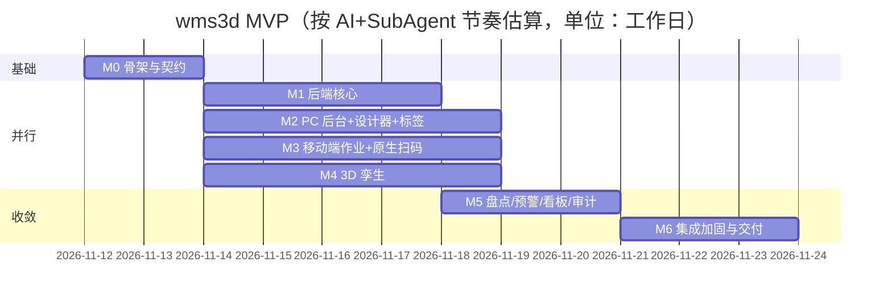

# 10 · 开发计划

## 1. 组织方式
- **Lead（Noa）**：维护 `packages/contracts`、`packages/domain` 公共接口、集成与评审、合并、发布；每个里程碑结束做演示检查点并更新本文档。
- **工作流（Workstream，可由独立 SubAgent 并行实施）**：

| WS | 名称 | 独占目录（写权限） | 依赖的契约 |
|---|---|---|---|
| WS-A | 后端 API | `apps/api/**` | contracts, domain, labels |
| WS-B | PC 后台 | `apps/admin/**`（不含 layout-designer） | contracts, api-client, twin3d |
| WS-C | 移动端 & 原生 | `apps/mobile/**`, `native/**`, `packages/scanner/**` | contracts, api-client, scanner, twin3d |
| WS-D | 3D & 布局设计器 | `packages/twin3d/**`, `apps/admin/src/features/layout-designer/**` | domain（TwinModel、LayoutDoc） |
| WS-E | 标签 | `packages/labels/**` | domain（编码） |
| WS-F | QA & DevOps | `infra/**`, `scripts/**`, `e2e/**`, 根配置 | 全部（只读） |

- **冲突规避规则**：①每个 WS 只改自己的目录；②契约变更（contracts/domain 公共类型）由 Lead 合入，WS 提"契约变更请求"文件 `docs/contract-requests/*.md`；③根 `package.json`/`pnpm-lock.yaml` 由 WS-F 统一合并（各 WS 在自己包内声明依赖，Lead 合并时重建 lockfile）；④每个 WS 在独立 git 分支 `ws-x/<task>` 开发，Lead 按里程碑合并到 `main`，合并前跑 `pnpm verify`。
- **完成定义（DoD）**：代码 + 单测/集成测 + 类型检查 + lint 通过；新增 API 在 OpenAPI 中；中文界面文案走 i18n；README/文档更新；演示脚本可复现。

## 2. 里程碑总览

M1–M4 在 M0 契约冻结后**并行**；各 WS 在对方未完成时用 contracts 生成的 **mock 服务**（MSW + 示例数据）开发。

## 3. 里程碑详情

### M0 · 骨架与契约（Lead + WS-F，串行，阻塞其他）
任务：
1. pnpm workspaces、TS 5 strict、ESLint（+boundaries）、Prettier、Vitest 根配置、`pnpm verify` 脚本。
2. `scripts/dev-db.sh`：用 `/opt/tools/pg17` 起本机 PG（端口 55432，数据目录 `.pgdata/`）；`.env.example`。
3. `packages/contracts`：枚举、错误码、全部 MVP 端点的 Zod 请求/响应 schema（先 schema 后实现）、OpenAPI 生成脚本。
4. `packages/domain`：类型 `LayoutDoc / TwinModel / LocationCodePattern`，函数签名 + 首批实现：`formatLocationCode/parseLocationCode`、`expandRack/expandLayout`、`validateLayout`、`classifyScan`（含单测）。
5. `apps/api` 空壳：Fastify + zod provider + 健康检查 + Drizzle schema（全部表）+ 首个迁移 + 触发器（ledger 只追加）。
6. `packages/api-client` 生成 + MSW mock（示例数据来自 seed 生成器）。
7. 各 app 空壳（admin/mobile Vite 起得来，Capacitor android 工程可 `assembleDebug`）。
验收：`pnpm verify` 全绿；`pnpm dev` 同时起 api/admin/mobile；OpenAPI 可在 `/api/docs` 查看；debug APK 生成成功。
**演示检查点 D0**：空壳登录页 + Swagger + APK 安装启动。

### M1 · 后端核心（WS-A）
1. 认证：登录/刷新轮换/登出、argon2id、限流、RBAC 中间件、仓库授权。
2. 用户管理、设备登记。
3. 仓库/库区/货架模板 CRUD；布局草稿保存（If-Match）、校验、**发布（差异计算 + 仓位稳定匹配）**。
4. SKU/条码 CRUD、条码命名空间冲突检查、CSV 导入（dryRun）/导出。
5. **库存引擎** `postTransaction`：INBOUND/OUTBOUND/TRANSFER/ADJUST，幂等（键+hash）、排序加锁、原子余额、movements、事件总线。
6. 查询：balances、movements、transactions、locate、scan/resolve、sync/masterdata、twin、twin/occupancy（ETag/since）。
7. SSE `/events`；审计写入器（基础）。
验收：并发/幂等/不变量测试通过（见 09）；所有端点集成测试；p95 < 150ms（本机 1k 次压测）。
**D1**：用 HTTP 脚本完成"建仓→发布布局→导入 SKU→上架→出库→查询"全链路。

### M2 · PC 后台 + 布局设计器 + 标签（WS-B、WS-D 设计器部分、WS-E）
WS-B：登录与布局框架、SKU 管理 + CSV 导入向导、仓位列表、库存查询/流水/交易、调整/移库、用户管理、标签打印页（预览/下载）。
WS-D（设计器）：Konva 画布、货架放置/拖动/吸附/旋转/阵列复制、库区多边形、属性面板、撤销重做、实时校验、草稿自动保存、发布差异确认弹窗、立面视图、3D 预览分屏。
WS-E：`packages/labels`：7 个模板 PDF 渲染、Code128/QR/EAN 矢量条码、中文字体子集、A4 偏移校准；条码回读测试；（ZPL 放 M5 可选）。API 端点 `/labels/render` 由 WS-A 接入（薄封装）。
验收：管理员 30 分钟内从零设计 200 仓位并打印 A4/100×50 标签，标签可被 ML Kit 与 HID 枪识读；Playwright 用例通过。
**D2**：录屏演示设计器 + 打印 PDF。

### M3 · 移动端作业 + 原生扫码（WS-C）
1. App 外壳：服务器配置（扫码）、登录、仓库切换、平板/手机自适应布局、网络/扫码源/待传状态栏。
2. `packages/scanner`：ScanHub、JS HID 缓冲、去重规范化、web mock。
3. `native/capacitor-scanner`（Kotlin）：HID `dispatchKeyEvent` 拦截（外接键盘识别、吞键）、SPP（已配对列表、RFCOMM 连接、帧切分、编码、自动重连）、权限处理、设置页"测试扫码"。
4. 相机：`@capacitor-mlkit/barcode-scanning@8` 连续扫描（捆绑模型），半屏取景 UI。
5. 作业页：上架、出库、移库、查询（状态机 + 连续模式 + 数量键盘 + 声光震动反馈）。
6. 离线：Dexie outbox、主数据增量缓存、发送器（串行 + 退避）、异常单页。
验收：Web 模拟扫码 e2e 全部通过；离线 e2e 不重复记账；APK 可装；真机清单（HID 枪、SPP 枪、相机）——若无真机，Kotlin 帧切分单测 + 模拟器键盘事件验证，真机项标记"待现场验证"。
**D3**：平板 + 枪连续上架 20 件视频 / 模拟器录屏。

### M4 · 3D 孪生（WS-D）
1. `packages/twin3d`：TwinModel → 场景（地面、库区、货架框架实例化、仓位实例化、透明/不透明分组）。
2. 着色模式 + 图例；拾取（BVH）+ 仓位卡片事件；相机预设与飞行聚焦；层过滤。
3. 高亮/定位（降饱和 + 脉冲 + 光柱）；LOD（远/中/近）；标签文本（近距离 ≤ 50）。
4. 局部颜色更新（`addUpdateRange`）；低端降级 2D 平面图。
5. 接入：移动端"3D"Tab + SKU 定位联动；PC"3D 孪生"大屏页；SSE 实时刷新（WS-B/WS-C 接线，WS-D 提供组件）。
6. 性能基准脚本（5k/20k）。
验收：5k 仓位 draw calls ≤ 60、三角形 ≤ 150k、Chrome 4× CPU 降速下交互流畅；定位 SKU 从搜索到相机聚焦 ≤ 1s。
**D4**：手机上搜索 SKU → 3D 高亮飞行演示。

### M5 · 盘点 / 预警 / 看板 / 审计（WS-A + WS-B + WS-C）
1. 盘点任务（后端 + PC 创建/审核/关闭 + 移动端盲盘作业），差异 = 计数 −（快照 + 期间流水）。
2. 低库存预警列表；看板（今日出入库、利用率、低库存、异常单数、对账状态）。
3. 审计日志页；夜间对账/清理任务。
4. 可选：ZPL 输出、"标签核对"模式（扫码点亮 3D）、热度着色。
验收：盘点全流程 e2e；对账任务能发现人为制造的不一致。
**D5**：盘点演示 + 看板。

### M6 · 集成加固与交付（全员，WS-F 主导）
1. 全量 e2e、性能、属性测试；安全检查（OWASP ASVS L1 清单、依赖审计、越权用例）。
2. `infra/` docker compose + Caddyfile + 备份/恢复脚本（在有 Docker 的环境验证；本机无 Docker 时以 PG 二进制 + node 进程跑等价冒烟）。
3. Release APK（签名流程文档化）、用户手册（中文：建仓、贴标、扫码枪配置卡、作业、盘点）、运维手册。
4. 演示数据与演示脚本；版本 `v0.1.0` 打 tag。
验收：从全新机器按 README 30 分钟内部署成功；全部验收标准（00 文档）逐条打勾。
**D6**：交付评审。

## 4. 并行与依赖矩阵
| | M0 | M1 | M2 | M3 | M4 | M5 | M6 |
|---|---|---|---|---|---|---|---|
| WS-A | 协助 | ●主 | 标签端点 | 支持 | twin 端点 | ● | 修复 |
| WS-B | – | – | ●主 | – | 接线 | ● | 修复 |
| WS-C | – | – | – | ●主 | 接线 | ● | 修复 |
| WS-D | – | – | ●设计器 | – | ●主 | 热度 | 修复 |
| WS-E | – | – | ●主 | – | – | ZPL | 修复 |
| WS-F | ●主 | CI/seed | e2e | e2e | 性能 | e2e | ●主 |
关键路径：M0 → M1（库存引擎）→ M5 → M6。M2/M3/M4 基于 mock 并行，M1 完成后切换到真实 API 做联调（每个 WS 预留 0.5 天）。

## 5. 风险登记
| # | 风险 | 影响 | 应对 |
|---|---|---|---|
| R1 | 扫码枪型号差异（SPP 帧格式、编码、HID 键盘布局、中文输入法吞字符） | 现场扫不进 | 原生 HID 拦截 + 可配置终止符/编码 + 扫码枪配置卡 + "测试扫码"页；尽早拿 1–2 款真机测 |
| R2 | 国内机型无 GMS | 相机扫码不可用 | 用 ML Kit **捆绑模型** `startScan`，不用 Google code scanner；兜底 zxing-wasm |
| R3 | 中低端机 WebView 3D 性能 | 卡顿 | 实例化 + 按需渲染 + dpr 限制 + LOD + 2D 降级；M4 早期真机基准 |
| R4 | 离线出库冲突 | 超卖/异常单 | 服务端原子校验拒绝 + 异常单流程；离线出库明确提示 |
| R5 | 布局发布改变仓位导致库存"悬空" | 数据错误 | 稳定匹配 + 有库存仓位禁止删除 + 差异确认 |
| R6 | 标签打印缩放/分辨率 | 识读率低 | 矢量条码 + dpi 对齐 + "实际大小"指引 + 回读测试 + 校准偏移 |
| R7 | 本机无 Docker/apt 不通 | 部署验证受限 | 本机用 PG 二进制 + node 跑等价环境；compose 在目标服务器验证 |
| R8 | 依赖版本漂移（Prisma 8 仅 RC、Capacitor 插件跟版本） | 构建失败 | 选 Drizzle；锁定版本；M0 生成 APK 冒烟 |
| R9 | 多 Agent 并行冲突 | 合并困难 | 目录独占 + 契约先行 + mock + Lead 统一合并 |
