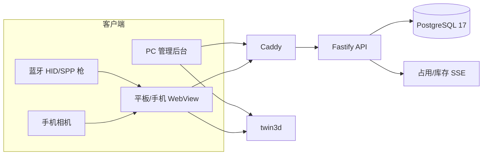

# wms3d v0.1.0 交付说明

仓库三维数字化仓储管理系统（WMS3D）：PC 管理后台 + 平板/手机作业端 + 蓝牙扫码枪 + 3D 数字孪生。本版本对应开发计划 M0–M6，tag `v0.1.0`。

## 1. 交付了什么

| 产物 | 路径 |
|---|---|
| 源码（本地 git） | `/workspace/wms3d`，tag `v0.1.0` |
| 管理后台 / API / 移动端 Web | monorepo：`apps/admin`、`apps/api`、`apps/mobile` |
| Android debug APK（发布质量构建） | `/workspace/wms3d-artifacts/wms3d-v0.1.0.apk` |
| 服务器发布包（API + 后台静态 + 运维脚本） | `/workspace/wms3d-artifacts/wms3d-v0.1.0-server/` |
| 演示截图（同一 `seed:demo` 实例） | `/workspace/wms3d-artifacts/screens/v0.1.0/` |
| 用户手册 / 真机清单 | 本目录 `USER-MANUAL.md`、`DEVICE-VERIFICATION.md` |

已验证路径：本机 PostgreSQL 17 + Node 24 + `infra/native/install.sh --foreground`。Docker compose 随仓库提供，**未在本机验证**。

## 2. 架构



- 契约优先：`packages/contracts`（Zod）生成类型与 OpenAPI。
- 库存：不可变流水 + 物化余额同事务更新；移动端离线队列以幂等键补传。
- 3D：`packages/twin3d` 在 PC 与移动端复用，WebGL2 不可用时降级 2D。

## 3. 五分钟本地启动

需已 `source /opt/tools/env.sh`，PostgreSQL 17 在 `127.0.0.1:55432`。

```bash
cd /workspace/wms3d
pnpm install
# 如本 worktree 已有 .env.local，可直接：
pnpm seed:demo          # 重建开发库：主数据 + 约 65% 库存 + 多日台账 + 低库存 + 进行中盘点
pnpm dev:api            # 另开终端
pnpm dev:admin
pnpm dev:mobile
```

- 管理后台：`http://127.0.0.1:$PORT_ADMIN`（Lead 默认 4010）
- 移动端 Web：`http://127.0.0.1:$PORT_MOBILE`（默认 4020）
- API：`http://127.0.0.1:$PORT_API/api/v1/health`（默认 4000）

没有 `.env.local` 时，用 `bash scripts/wt.sh` 或参考 `docs/dev-setup.md` 创建。生产部署见发布包内 `DEPLOY.md` 与 `infra/native/install.sh`。

## 4. 默认账号与如何改密

演示密码统一为 `Wms3d#demo`（见 `packages/domain` 的 `DEMO_PASSWORD`）。

| 用户名 | 角色 | 用途 |
|---|---|---|
| admin | 系统管理员 | 用户、仓库、布局发布 |
| manager | 仓库主管 | SKU、标签、盘点审核、预警 |
| op1 / op2 | 仓管员 | 扫码作业、盲盘 |
| viewer | 只读 | 看板、查询、3D |

修改密码：登录后台 →「系统 → 用户与设备」重置；或本人在个人菜单改密。生产环境请立刻修改演示密码，并用 `pnpm --filter @wms3d/api admin:create` 创建真实管理员（强制首登改密）。不要把演示口令用于现场。

## 5. 功能对照（需求 → 实现）

| 需求 | 实现 |
|---|---|
| 平板 + 蓝牙 SPP/HID 扫码枪 | 移动端 scanner 插件：pre-IME HID 拦截 + SPP 帧；可配终止符/白名单 |
| 手机相机扫码 | ML Kit / 模拟相机；瞄准框与连续扫 |
| PC 管理后台 | `apps/admin` |
| 仓位管理 | 布局发布投影、仓位批量停用、编码规则 |
| 仓位/货架标签 | 多模板 PDF、校准页、补打队列、回读核对；ZPL 实验性 |
| 扫码入出库 | 连续上架/拣货、默认数量、空闲自动提交、10 秒撤销 |
| 布局设计器 | 2D 拖拽、吸附、阵列、校验发布、3D 预览 |
| 移动端 3D 孪生 | 占用着色、图例、点选、离线显示上次布局 |
| SKU 定位 | 后台/移动搜索或扫码 → 3D 高亮并框住货架 |
| 库存查询 | 按 SKU/仓位/条码，流水台账，CSV 导出 |
| 盘点 / 低库存 / 看板 / 审计 | 任务、盲盘、差异审核、调整过账、预警、KPI、审计日志 |
| 标签核对 | 扫描点亮 3D，列出漏贴/错贴 |

## 6. 已知限制

- 真机门禁（HID 中文输入法、SPP 休眠首枪、相机误读、离线补传、实机打印、中端平板 3D 帧率、华为/无 GMS）**尚未在现场设备上执行**，详见 `DEVICE-VERIFICATION.md`。
- Docker compose **未在本机验证**；已验证路径为原生 systemd / `--foreground`。
- 异地备份（`BACKUP_REMOTE`）未配置时，看板会提示「备份与数据同盘」，上线签字前需配置。
- ZPL 为实验能力，默认交付路径是 PDF。
- 不做采购/销售/波次/FEFO/序列号/多租户/iOS/AGV/RFID/BLE 枪。
- 角色为全局单角色，不能「WH1 主管 + WH2 操作员」。
- 演示布局为 60×40×10m、约四百个仓位量级的教学数据，不是文档愿景中的三千仓位满配仓。

## 7. 路线图（M6 之后）

- 完成真机验收并补齐现场脚本；配置异地备份与可选 WAL 归档。
- 若需要，扩充演示/生产布局规模，并做 20k 仓位真机帧率确认。
- 完善 ZPL 与真实打印机驱动指引；评估 Docker 路径是否升级为已验证。
- 可选：按仓角色覆盖、与 ERP 参考单号对接。
